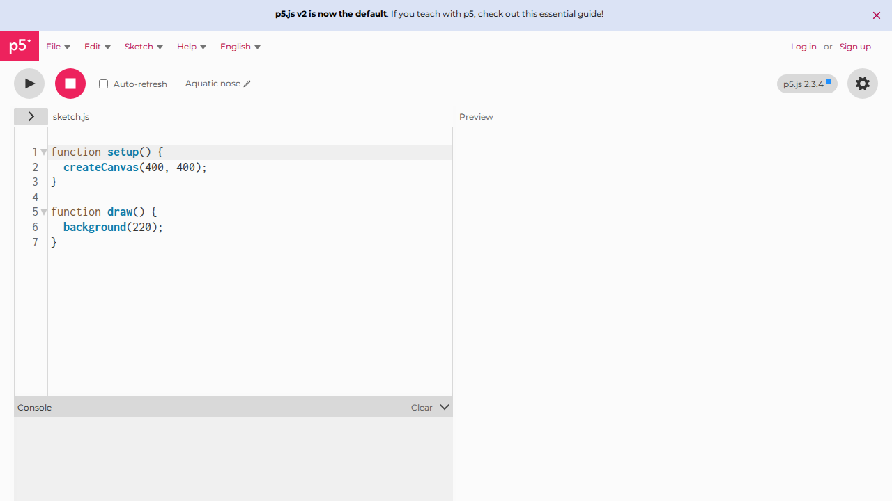
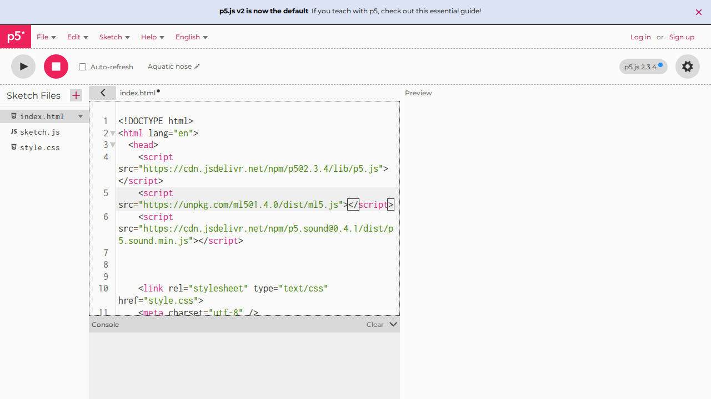
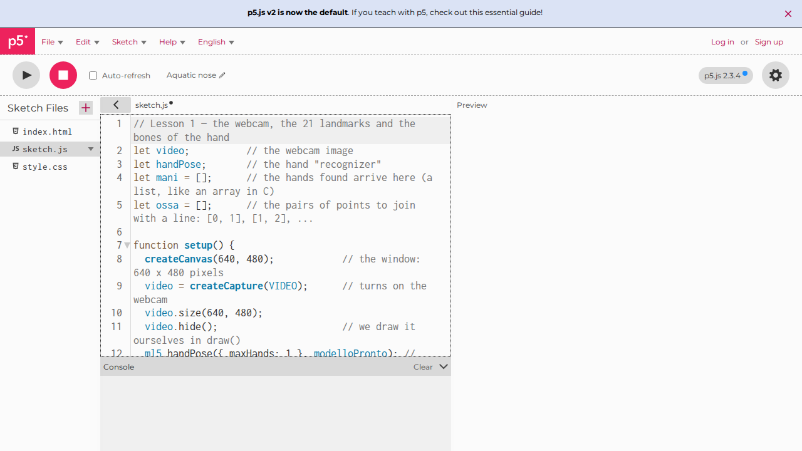
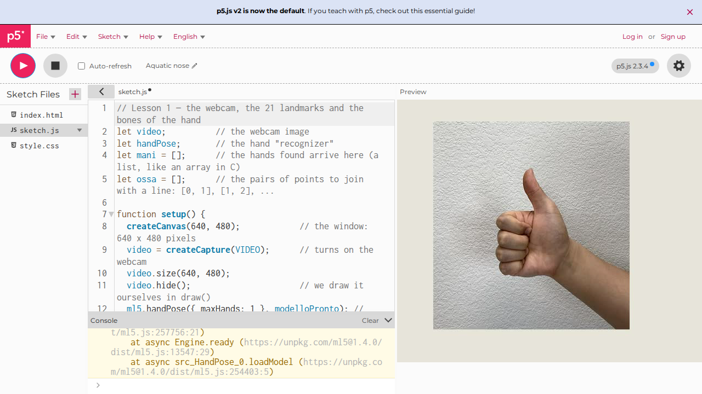
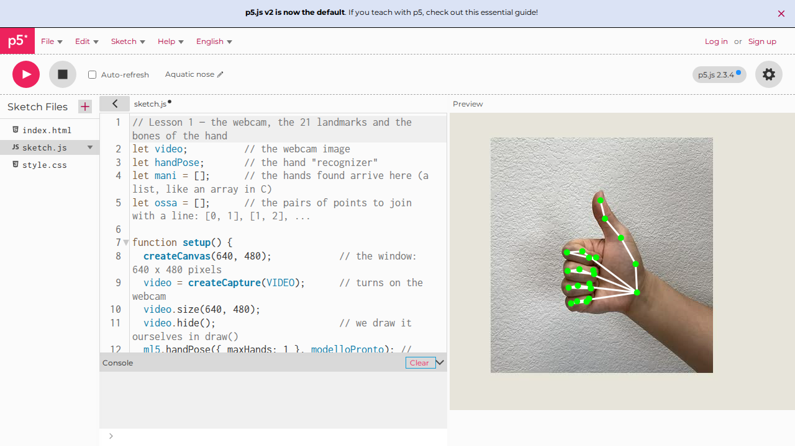
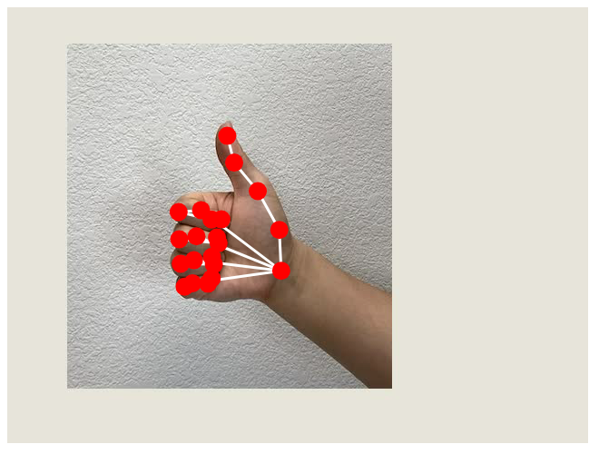
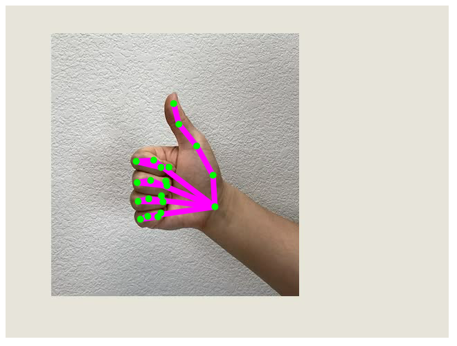
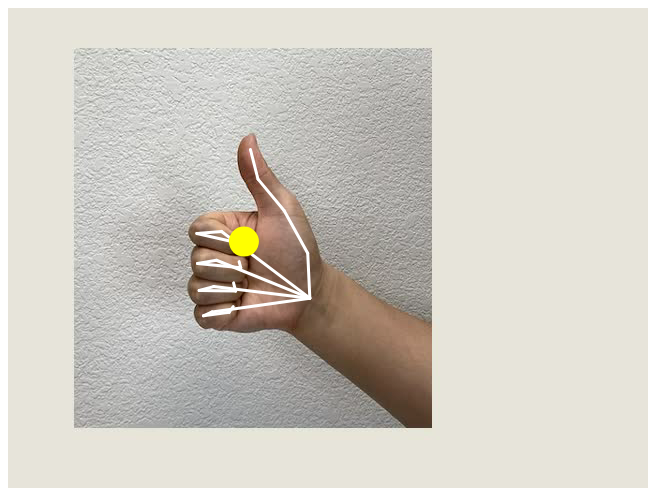
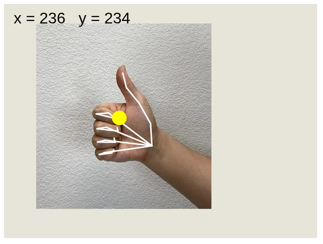

# Lesson 1 · The points and the bones of the hand

!!! success "What you get at the end of this lesson"
    **Your webcam on screen, with your hand drawn on top: 21 green dots (the points) joined by white lines (the bones).**
    Move your hand and the drawing follows it; close your fingers and the drawing closes with them.

    { width="480" }

    **Time:** 60 minutes · **Lines of code:** about 45 · **You need:** a PC with a webcam, Chrome or Edge, internet

There is only one program, and you build it in three steps:

1. **Get it running** (15 min): you copy the code into the editor and see it work.
2. **Understand it** (25 min): we read it one piece at a time, comparing it with the C you know.
3. **Change it** (20 min): four exercises, each one changes something you see on screen.

To keep things simple the program looks for **one hand only**: if you show two, it draws one.

---

## 1. Get it running

### Step 1 — Open the editor

Go to <https://editor.p5js.org/>. The p5.js editor opens: **the code on the left**, **the result on
the right** (empty for now). You do not need to sign up to try it.



!!! success "Check"
    Do you see the round **▶** button at the top left and the `sketch.js` file with `setup` and `draw`
    inside? You are in the right place.

### Step 2 — Add the library that recognizes the hand

The project has several files. To see them, click the small arrow **›** at the top left, above the
code: the **Sketch Files** list appears. Click **`index.html`**.

Find the line that loads p5.js: it contains `p5.js` or `p5.min.js` and ends with `</script>`.
Put the cursor **at the end of that line**, after `</script>`, press **Enter** and type (or paste)
this new line:

```html
<script src="https://unpkg.com/ml5@1.4.0/dist/ml5.js"></script>
```



!!! tip "Why"
    It is like an `#include` in C: without this line the program does not know what `ml5` is.
    **p5.js** is for drawing; **ml5.js** contains the artificial intelligence model that finds the
    hand. The number `1.4.0` is the version: we pin it, so the code always works the same way.

!!! warning "Watch out"
    The new line goes **after** `</script>`, not in the middle. Long lines wrap by themselves in the
    editor: look at the number on the left to see where a line really ends.

### Step 3 — Paste the program

In the file list go back to **`sketch.js`**. Delete everything in it (Ctrl+A, then Delete) and
paste this program (the button at the top right of the box copies it):

```javascript
--8<-- "codice/lezione-01.en.js"
```



### Step 4 — Press ▶

1. Press **▶** (Play) at the top.
2. The browser asks for permission to use the **webcam**: allow it.
3. At first you only see the webcam image: the model is downloading, it takes a few seconds.

    

4. Put your hand in front of the webcam: the dots and the lines appear.

    

!!! success "Check"
    Do you see the green dots and the white lines on your hand? **The program works.** If not, see
    [If it does not work](#if-it-does-not-work) at the bottom of the page.

---

## 2. Understand it

### From C to JavaScript: the five differences you need today

The program is written in **JavaScript**, the language of browsers. It is much closer to C than it
looks:

| In C | In JavaScript | What changes |
|---|---|---|
| `int x = 5;` | `let x = 5;` | You do not write the type: `let` works for numbers, text, arrays |
| `void disegna() { ... }` | `function disegna() { ... }` | Instead of the return type you write `function` |
| `int v[21];` and you remember the length yourself | `let v = [];` and `v.length` | The array knows its length and can grow |
| `p.x` on a `struct` | `punto.x` on an object | Same: you read a field with the dot |
| The program starts from `main()` | `setup()` and `draw()` start by themselves | See below |

### No `main`: `setup()` and `draw()`

With p5.js you do not write `main`. You write two functions, and p5.js calls them for you:

```c
// it is as if p5.js had written this main for you:
int main() {
    setup();          // only once, at the start
    while (1) {
        draw();       // forever, about 60 times per second
    }
}
```

- In **`setup()`** you prepare things: the window, the webcam, the recognizer.
- In **`draw()`** you draw one frame. Since it is called over and over, what you draw updates by
  itself: that is how the drawing follows the hand.

### The variables at the top

```javascript
let video;          // the webcam image
let handPose;       // the hand "recognizer"
let mani = [];      // the hands found arrive here
let ossa = [];      // the pairs of points to join with a line
```

They are **global variables**, like the ones written outside `main` in C: every function can see
them. `mani` (hands) and `ossa` (bones) start as empty arrays (`[]`): they fill up when the model
is ready.

### `setup()`: everything is prepared, only once

| Line | What it does | Why |
|---|---|---|
| `createCanvas(640, 480);` | Creates the drawing window, 640 × 480 pixels | It is the sheet we draw on |
| `video = createCapture(VIDEO);` | Turns on the webcam | The images to look at come from here |
| `video.size(640, 480);` | Gives the video the same size as the window | So the points found land in the right place of the drawing |
| `video.hide();` | Hides the "raw" video | We draw it ourselves in `draw()`, under the points |
| `ml5.handPose({ maxHands: 1 }, modelloPronto);` | Downloads the model that recognizes hands | `maxHands: 1` means "look for **at most one** hand": the program is simpler and faster |

`{ maxHands: 1 }` is an **object** with a single field: it is like passing a small `struct` of
options. If one day you want two hands, just write `2`.

### The functions called «when it is ready»

There are two functions that nobody calls explicitly: `modelloPronto` (model ready) and
`maniTrovate` (hands found). We pass them by name to ml5, and ml5 calls them **when it has
finished a job**:

- `ml5.handPose(..., modelloPronto)`: «download the model and, when you are done, call
  `modelloPronto`»;
- `handPose.detectStart(video, maniTrovate)`: «watch the video continuously, and every time you have
  found the hand call `maniTrovate` with the results».

It is the same trick as function pointers in C: you pass a function as an argument, and someone else
will call it at the right moment.

Inside `modelloPronto` there is also the new line for the bones:

```javascript
ossa = handPose.getConnections();   // asks the model which points must be joined
```

The model already knows which points are connected (the wrist to the thumb, the knuckle to the
finger bone, …) and gives them to us as an **array of pairs**: `[[0, 1], [1, 2], [2, 3], ...]`. The
pair `[0, 1]` means «join point 0 with point 1». It is like an `int ossa[N][2]` matrix in C.

### What is inside `mani`

`mani` is an **array of hands**: empty if there is no hand, with a single element when it finds one
(we asked for `maxHands: 1`). Each hand has a `keypoints` field, an **array of 21 points**; each
point has `x` and `y`, in pixels, like the window.

The points are always numbered the same way:

| Number | Where |
|---|---|
| 0 | the wrist |
| 1 – 4 | the thumb, from the base to the **tip (4)** |
| 5 – 8 | the index finger, from the knuckle to the **tip (8)** |
| 9 – 12 | the middle finger, **tip 12** |
| 13 – 16 | the ring finger, **tip 16** |
| 17 – 20 | the little finger, **tip 20** |

So `mano.keypoints[8].x` is the x of the index fingertip. You will need this table in all the next
lessons.

### `draw()`: one frame, in four moves

**1) The webcam.** `image(video, 0, 0);` draws the webcam image starting from the top left corner.
It must be drawn **first**: whatever you draw afterwards ends up on top.

**2) Is there a hand?**

```javascript
if (mani.length > 0) {   // if it found the hand...
  let mano = mani[0];    // ...the first (and only) one in the list
```

If the array is empty there is nothing to draw. The check matters: reading `mani[0]` when `mani`
is empty would be like reading outside an array in C.

**3) The bones.**

```javascript
stroke(255, 255, 255);   // line colour: white
strokeWeight(3);         // thickness: 3 pixels
for (let i = 0; i < ossa.length; i++) {
  let a = mano.keypoints[ossa[i][0]];  // the point where the bone starts
  let b = mano.keypoints[ossa[i][1]];  // the point where it ends
  line(a.x, a.y, b.x, b.y);            // a line from a to b
}
```

For each pair, we take the two points and draw a line from one to the other. `ossa[i][0]` is a
number (for example 5), and `mano.keypoints[5]` is the point with that number: one array used as
the index of another array, as you would do in C.

**4) The points.** With `noStroke()` we remove the outline, with `fill(0, 255, 0)` we choose green,
then a `for` loop draws a `circle` on each of the 21 points. The points come **after** the bones, so
they sit on top of the lines and are easy to see.

### The p5.js drawing functions used today

| Function | What it does |
|---|---|
| `createCanvas(640, 480)` | Creates the drawing window, 640 × 480 pixels. The origin (0, 0) is **at the top left**, and y grows **downwards** |
| `image(video, 0, 0)` | Draws the webcam image, starting from the top left corner |
| `stroke(r, g, b)` | Chooses the colour of lines and outlines: red, green, blue, from 0 to 255 |
| `strokeWeight(n)` | Chooses the thickness of lines, in pixels |
| `line(x1, y1, x2, y2)` | A line from point (x1, y1) to point (x2, y2) |
| `fill(r, g, b)` | Chooses the fill colour |
| `noStroke()` | No outline around shapes |
| `circle(x, y, d)` | A circle with centre (x, y) and diameter d |

!!! warning "The image is not a mirror"
    If you raise your right hand, on screen you see it on the left, as in a photo. That is normal:
    for now it is perfectly fine.

---

## 3. Change it

Do the exercises in order. After each change press **▶** and check that what you expected happened
on screen.

### Exercise 1 — Red, bigger dots

**Result:** the dots become red and twice as big.

??? example "Solution"
    In the **4) the points** part, change the colour and the diameter:
    ```javascript
    fill(255, 0, 0);               // red
    circle(punto.x, punto.y, 20);  // diameter 20 instead of 10
    ```
    { width="400" }

### Exercise 2 — Coloured bones

**Result:** the lines become purple and much thicker.

*Hint:* `stroke` chooses the colour of the lines, `strokeWeight` their thickness.

??? example "Solution"
    In the **3) the bones** part:
    ```javascript
    stroke(255, 0, 255);   // purple: red + blue
    strokeWeight(8);       // 8 pixels instead of 3
    ```
    { width="400" }

### Exercise 3 — Only the index fingertip

**Result:** instead of the 21 dots, **only one** dot remains, big and yellow, on the index
fingertip. The bones stay.

*Hint:* the index fingertip is point number 8. You do not need the `for` loop of the points.

??? example "Solution"
    Instead of the `for` loop of the points (after `noStroke();`):
    ```javascript
    let punta = mano.keypoints[8];   // the index fingertip
    fill(255, 255, 0);               // yellow
    circle(punta.x, punta.y, 30);
    ```
    { width="400" }

### Exercise 4 — Where is the finger?

**Result:** at the top left the coordinates of the index fingertip appear, for example
`x = 312   y = 145`, and they change as you move your finger.

*Hint:* `text("hello", 20, 40)` writes «hello» at position (20, 40); `textSize(32)` chooses the
size. In JavaScript texts are joined with `+`, and `round()` removes the decimals.

??? example "Solution"
    Below the yellow dot of exercise 3:
    ```javascript
    fill(0);                         // black: readable even on a light wall
    textSize(32);
    text("x = " + round(punta.x) + "   y = " + round(punta.y), 20, 40);
    ```
    { width="400" }

    Try moving your finger upwards: **y decreases**. Remember this, you will need it in lesson 2 to
    tell whether a finger is raised.

---

## If it does not work

| What you see | What to do |
|---|---|
| The right side stays empty, no webcam | The browser has no permission: click the webcam icon in the address bar and allow it, then press ▶ again |
| The webcam shows, but no dots | Wait 10–20 seconds: the first time the model is downloading. Then check that the hand is well lit and fully in the image |
| Below the code it says `ml5 is not defined` | The line from step 2 is missing in `index.html`, mistyped, or ended up in the middle of the p5.js line |
| Another red error below the code | You deleted or changed a piece by mistake: paste the program from step 3 again |
| You show two hands but only one is drawn | That is correct: the program looks for one hand only (`maxHands: 1`) |

## The next lesson

**Lesson 2 · How many fingers?** At the end you will have on screen a **big number telling how many
fingers you are raising**, from 0 to 5. You will use one `if` per finger: is the tip higher than the
knuckle?
