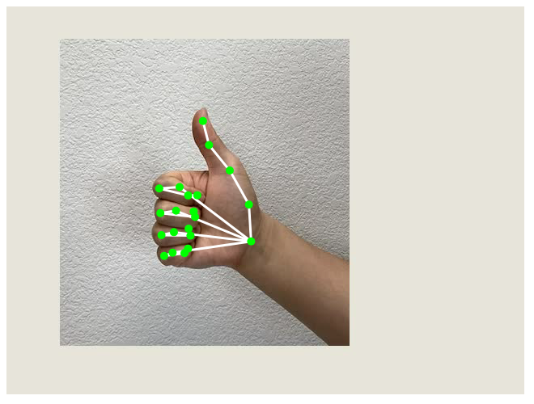

# Lesson 1 · The hand landmarks

!!! success "What you get at the end of this lesson"
    **Your webcam on screen, with 21 green dots following your hand.**
    Move your hand and the dots follow it; close your fingers and the dots close with them.

    { width="480" }

    **Time:** 60 minutes · **Lines of code:** about 30 · **You need:** a PC with a webcam, Chrome or Edge, internet

There is only one program, and you build it in three steps:

1. **Get it running** (15 min): you copy the code into the editor and see it work.
2. **Understand it** (25 min): we read it line by line, comparing it with the C you know.
3. **Change it** (20 min): three exercises, each one changes something you see on screen.

---

## 1. Get it running

### Step 1 — Open the editor

Go to <https://editor.p5js.org/>. The editor opens: **the code on the left**, **the result on the
right** (for now a grey square). You do not need to sign up to try it.

### Step 2 — Add the library that recognizes the hand

The project has several files. To see them, click the small arrow **›** at the top left, above the
code: the list of files appears. Open **`index.html`**.

Find the line that loads p5.js (it contains `p5.js` or `p5.min.js`) and **right below it** add this one:

```html
<script src="https://unpkg.com/ml5@1.4.0/dist/ml5.js"></script>
```

Then go back to the **`sketch.js`** file.

!!! tip "Why"
    It is like an `#include` in C: without this line the program does not know what `ml5` is.

### Step 3 — Paste the program

In `sketch.js` delete everything and paste this (the button at the top right of the box copies it):

```javascript
--8<-- "codice/lezione-01.en.js"
```

### Step 4 — Press ▶

1. Press **▶** (Play) at the top.
2. The browser asks for permission to use the **webcam**: allow it.
3. Wait a few seconds (the model is downloading) and put your hand in front of the webcam.

!!! success "Check"
    Do you see the green dots on your hand? **The program works.** If not, see
    [If it does not work](#if-it-does-not-work) at the bottom of the page.

---

## 2. Understand it

### From C to JavaScript: the five differences you need today

The program is written in **JavaScript**, the language of browsers. It is much closer to C than it
looks:

| In C | In JavaScript | What changes |
|---|---|---|
| `int x = 5;` | `let x = 5;` | You do not write the type: `let` works for numbers, text, arrays |
| `void disegna() { ... }` | `function disegna() { ... }` | Instead of the return type you write `function` |
| `int v[21];` and you remember the length yourself | `let v = [];` and `v.length` | The array knows its length and can grow |
| `p.x` on a `struct` | `punto.x` on an object | Same: you read a field with the dot |
| The program starts from `main()` | `setup()` and `draw()` start by themselves | See below |

### No `main`: `setup()` and `draw()`

With p5.js you do not write `main`. You write two functions, and p5.js calls them for you:

```c
// it is as if p5.js had written this main for you:
int main() {
    setup();          // only once, at the start
    while (1) {
        draw();       // forever, about 60 times per second
    }
}
```

- In **`setup()`** you prepare things: the window, the webcam, the recognizer.
- In **`draw()`** you draw one frame. Since it is called over and over, what you draw updates by
  itself: that is how the dots follow the hand.

### The functions called «when it is ready»

There are two functions that nobody calls explicitly: `modelloPronto` and `maniTrovate`. We pass
them by name to ml5, and ml5 calls them **when it has finished a job**:

- `ml5.handPose(modelloPronto)`: «download the model and, when you are done, call `modelloPronto`»;
- `handPose.detectStart(video, maniTrovate)`: «watch the video continuously, and every time you have
  found the hands call `maniTrovate` with the results».

It is the same trick as function pointers in C: you pass a function as an argument, and someone else
will call it at the right moment.

### What is inside `mani`

`mani` is an **array of hands** (empty if there are none, up to two). Each hand has a `keypoints`
field, an **array of 21 points**; each point has `x` and `y`, in pixels, like the window.

The points are always numbered the same way:

| Number | Where |
|---|---|
| 0 | the wrist |
| 1 – 4 | the thumb, from the base to the **tip (4)** |
| 5 – 8 | the index finger, from the knuckle to the **tip (8)** |
| 9 – 12 | the middle finger, **tip 12** |
| 13 – 16 | the ring finger, **tip 16** |
| 17 – 20 | the little finger, **tip 20** |

So `mano.keypoints[8].x` is the x of the index fingertip. You will need this table in all the next
lessons.

### The two `for` loops in `draw()`

```javascript
for (let i = 0; i < mani.length; i++) {              // for each hand...
  let mano = mani[i];
  for (let j = 0; j < mano.keypoints.length; j++) {  // ...for each of the 21 points
    let punto = mano.keypoints[j];
    circle(punto.x, punto.y, 10);                    // a dot there
  }
}
```

They are two `for` loops one inside the other, exactly as in C. The only new thing is `.length`
instead of a constant written by hand.

### The p5.js drawing functions used today

| Function | What it does |
|---|---|
| `createCanvas(640, 480)` | Creates the drawing window, 640 × 480 pixels. The origin (0, 0) is **at the top left**, and y grows **downwards** |
| `image(video, 0, 0)` | Draws the webcam image, starting from the top left corner |
| `fill(r, g, b)` | Chooses the fill colour: red, green, blue, from 0 to 255 |
| `noStroke()` | No outline around shapes |
| `circle(x, y, d)` | A circle with centre (x, y) and diameter d |

!!! warning "The image is not a mirror"
    If you raise your right hand, on screen you see it on the left, as in a photo. That is normal:
    for now it is perfectly fine.

---

## 3. Change it

Do the exercises in order. After each change press **▶** and check that what you expected happened
on screen.

### Exercise 1 — Red, bigger dots

**Result:** the dots become red and twice as big.

??? example "Solution"
    Change the two lines inside the second `for`:
    ```javascript
    fill(255, 0, 0);               // red
    circle(punto.x, punto.y, 20);  // diameter 20 instead of 10
    ```

### Exercise 2 — Only the index fingertip

**Result:** **only one** dot remains on screen, big and yellow, on the index fingertip.

*Hint:* the index fingertip is point number 8. You do not need the second `for`.

??? example "Solution"
    Instead of the second `for`:
    ```javascript
    let punta = mano.keypoints[8];   // the index fingertip
    fill(255, 255, 0);               // yellow
    circle(punta.x, punta.y, 30);
    ```

### Exercise 3 — Where is the finger?

**Result:** at the top left the coordinates of the index fingertip appear, for example
`x = 312   y = 145`, and they change as you move your finger.

*Hint:* `text("hello", 20, 40)` writes «hello» at position (20, 40); `textSize(32)` chooses the
size. In JavaScript texts are joined with `+`, and `round()` removes the decimals.

??? example "Solution"
    Below the yellow dot of exercise 2:
    ```javascript
    fill(0);                         // black: readable even on a light wall
    textSize(32);
    text("x = " + round(punta.x) + "   y = " + round(punta.y), 20, 40);
    ```
    Try moving your finger upwards: **y decreases**. Remember this, you will need it in lesson 2 to
    tell whether a finger is raised.

---

## If it does not work

| What you see | What to do |
|---|---|
| The square stays grey, no webcam | The browser has no permission: click the webcam icon in the address bar and allow it, then press ▶ again |
| The webcam shows, but no dots | Wait 10–20 seconds: the first time the model is downloading. Then check that the hand is well lit and fully in the image |
| Below the code it says `ml5 is not defined` | The line from step 2 is missing in `index.html`, or it is mistyped |
| Another red error below the code | You deleted or changed a piece by mistake: paste the program from step 3 again |

## The next lesson

**Lesson 2 · How many fingers?** At the end you will have on screen a **big number telling how many
fingers you are raising**, from 0 to 5. You will use one `if` per finger: is the tip higher than the
knuckle?
