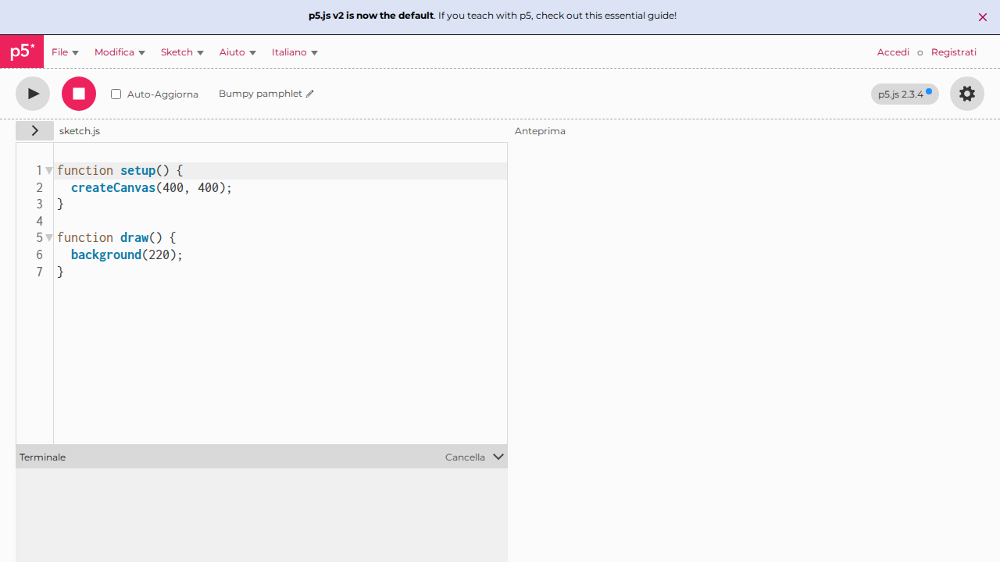
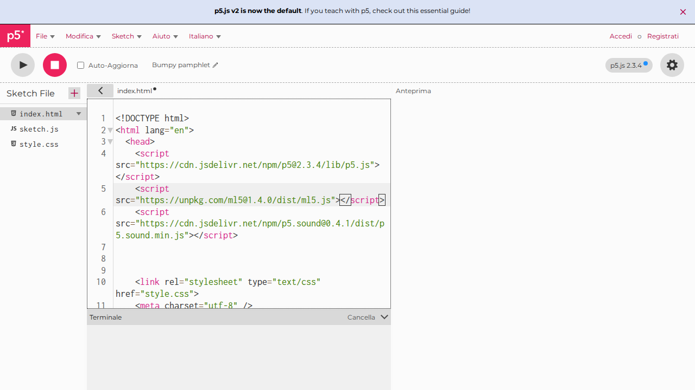
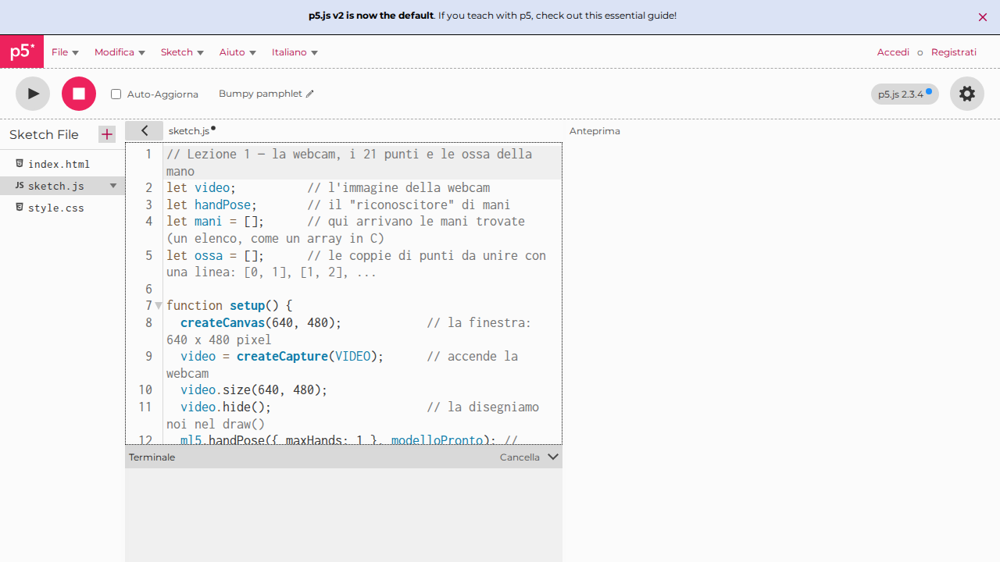
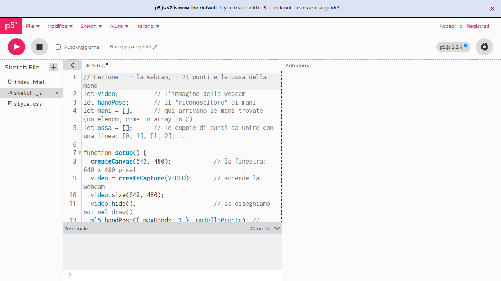
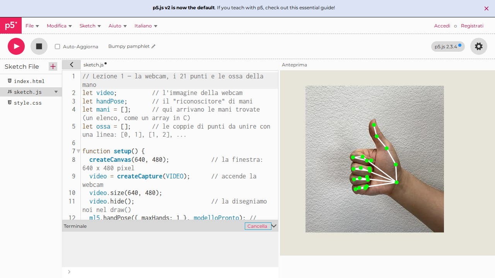

# Lezione 1 · I punti e le ossa della mano

!!! success "Cosa ottieni alla fine di questa lezione"
    **La tua webcam sullo schermo, con la tua mano disegnata sopra: 21 pallini verdi (i punti) uniti da linee bianche (le ossa).**
    Muovi la mano e il disegno la segue; chiudi le dita e il disegno si chiude con loro.

    { width="480" }

    **Tempo:** 60 minuti · **Righe di codice:** circa 45 · **Ti serve:** PC con webcam, Chrome o Edge, internet

Il programma è uno solo e lo costruisci in tre passi:

1. **Farlo partire** (15 min): copi il codice nell'editor e lo vedi funzionare.
2. **Capirlo** (25 min): lo leggiamo un pezzo alla volta, confrontandolo con il C che conosci.
3. **Modificarlo** (20 min): quattro esercizi, ognuno cambia una cosa che vedi sullo schermo.

Per tenere le cose semplici il programma cerca **una mano sola**: se ne mostri due, ne disegna una.

---

## 1. Farlo partire

### Passo 1 — Apri l'editor

Vai su <https://editor.p5js.org/>. Si apre l'editor di p5.js: **a sinistra il codice**, **a destra
il risultato** (che per ora è vuoto). Non serve registrarsi per provare.



!!! success "Controllo"
    Vedi il pulsante rotondo **▶** in alto a sinistra e il file `sketch.js` con dentro `setup` e `draw`?
    Sei nel posto giusto.

### Passo 2 — Aggiungi la libreria che riconosce la mano

Il progetto ha più file. Per vederli, clicca la piccola freccia **›** in alto a sinistra, sopra il
codice: compare l'elenco dei file (**Sketch File**). Clicca **`index.html`**.

Cerca la riga che carica p5.js: contiene `p5.js` o `p5.min.js` e finisce con `</script>`.
Metti il cursore **alla fine di quella riga**, dopo `</script>`, premi **Invio** e scrivi (o incolla)
questa riga nuova:

```html
<script src="https://unpkg.com/ml5@1.4.0/dist/ml5.js"></script>
```



!!! tip "Perché"
    È come un `#include` in C: senza questa riga il programma non sa cosa sia `ml5`.
    **p5.js** serve per disegnare; **ml5.js** contiene il modello di intelligenza artificiale che
    trova la mano. Il numero `1.4.0` è la versione: la fissiamo, così il codice funziona sempre
    allo stesso modo.

!!! warning "Attenzione"
    La riga nuova va **dopo** `</script>`, non in mezzo. Le righe lunghe nell'editor vanno a capo
    da sole: guarda il numero a sinistra per capire dove finisce davvero una riga.

### Passo 3 — Incolla il programma

Nell'elenco dei file torna a **`sketch.js`**. Cancella tutto quello che c'è (Ctrl+A e poi Canc) e
incolla questo programma (il pulsante in alto a destra del riquadro lo copia):

```javascript
--8<-- "codice/lezione-01.js"
```



### Passo 4 — Premi ▶

1. Premi **▶** (Play) in alto.
2. Il browser chiede il permesso di usare la **webcam**: concedilo.
3. Prima compare solo l'immagine della webcam: il modello si sta scaricando, ci vuole qualche secondo.

    

4. Metti la mano davanti alla webcam: compaiono i pallini e le linee.

    

!!! success "Controllo"
    Vedi i pallini verdi e le linee bianche sulla tua mano? **Il programma funziona.** Se no, guarda
    [Se non funziona](#se-non-funziona) in fondo alla pagina.

---

## 2. Capirlo

### Da C a JavaScript: le cinque differenze che servono oggi

Il programma è scritto in **JavaScript**, il linguaggio dei browser. È molto più vicino al C di
quanto sembri:

| In C | In JavaScript | Cosa cambia |
|---|---|---|
| `int x = 5;` | `let x = 5;` | Non si scrive il tipo: `let` va bene per numeri, testo, array |
| `void disegna() { ... }` | `function disegna() { ... }` | Al posto del tipo di ritorno si scrive `function` |
| `int v[21];` e la lunghezza la ricordi tu | `let v = [];` e `v.length` | L'array conosce la sua lunghezza e può crescere |
| `p.x` su una `struct` | `punto.x` su un oggetto | Uguale: si legge un campo con il punto |
| Il programma parte da `main()` | Partono da sole `setup()` e `draw()` | Vedi sotto |

### Niente `main`: `setup()` e `draw()`

Con p5.js non scrivi il `main`. Scrivi due funzioni, e p5.js le chiama al posto tuo:

```c
// è come se p5.js avesse scritto questo main per te:
int main() {
    setup();          // una volta sola, all'inizio
    while (1) {
        draw();       // per sempre, circa 60 volte al secondo
    }
}
```

- In **`setup()`** prepari le cose: la finestra, la webcam, il riconoscitore.
- In **`draw()`** disegni un fotogramma. Siccome viene chiamata di continuo, quello che disegni
  si aggiorna da solo: è così che il disegno segue la mano.

### Le variabili in cima

```javascript
let video;          // l'immagine della webcam
let handPose;       // il "riconoscitore" di mani
let mani = [];      // qui arrivano le mani trovate
let ossa = [];      // le coppie di punti da unire con una linea
```

Sono **variabili globali**, come quelle scritte fuori dal `main` in C: le vedono tutte le funzioni.
`mani` e `ossa` partono come array vuoti (`[]`): si riempiranno quando il modello sarà pronto.

### `setup()`: si prepara tutto, una volta sola

| Riga | Cosa fa | Perché |
|---|---|---|
| `createCanvas(640, 480);` | Crea la finestra di disegno, 640 × 480 pixel | È il foglio su cui disegnamo |
| `video = createCapture(VIDEO);` | Accende la webcam | Da qui arrivano le immagini da guardare |
| `video.size(640, 480);` | Dà al video la stessa misura della finestra | Così i punti trovati cadono nel posto giusto del disegno |
| `video.hide();` | Nasconde il video «grezzo» | Lo disegniamo noi in `draw()`, sotto ai punti |
| `ml5.handPose({ maxHands: 1 }, modelloPronto);` | Scarica il modello che riconosce le mani | `maxHands: 1` vuol dire «cerca **al massimo una** mano»: il programma è più semplice e più veloce |

`{ maxHands: 1 }` è un **oggetto** con un solo campo: è come passare una piccola `struct` di
opzioni. Se un giorno vorrai due mani, basterà scrivere `2`.

### Le funzioni chiamate «quando è pronto»

Ci sono due funzioni che nessuno chiama esplicitamente: `modelloPronto` e `maniTrovate`. Le
passiamo per nome a ml5, e ml5 le chiama **quando ha finito un lavoro**:

- `ml5.handPose(..., modelloPronto)`: «scarica il modello e, quando hai finito, chiama
  `modelloPronto`»;
- `handPose.detectStart(video, maniTrovate)`: «guarda il video di continuo, e ogni volta che hai
  trovato la mano chiama `maniTrovate` con i risultati».

È lo stesso trucco dei puntatori a funzione in C: passi una funzione come argomento, e la
chiamerà qualcun altro al momento giusto.

Dentro `modelloPronto` c'è anche la riga nuova delle ossa:

```javascript
ossa = handPose.getConnections();   // chiede al modello quali punti vanno uniti
```

Il modello sa già quali punti sono collegati (il polso al pollice, la nocca alla falange, …) e ce
li dà come un **array di coppie**: `[[0, 1], [1, 2], [2, 3], ...]`. La coppia `[0, 1]` vuol dire
«unisci il punto 0 con il punto 1». È come una matrice `int ossa[N][2]` in C.

### Cosa c'è dentro `mani`

`mani` è un **array di mani**: vuoto se non c'è nessuna mano, con un solo elemento quando la trova
(abbiamo chiesto `maxHands: 1`). Ogni mano ha un campo `keypoints`, un **array di 21 punti**; ogni
punto ha `x` e `y`, in pixel, come la finestra.

I punti sono sempre numerati nello stesso modo:

| Numero | Dove |
|---|---|
| 0 | il polso |
| 1 – 4 | il pollice, dalla base alla **punta (4)** |
| 5 – 8 | l'indice, dalla nocca alla **punta (8)** |
| 9 – 12 | il medio, **punta 12** |
| 13 – 16 | l'anulare, **punta 16** |
| 17 – 20 | il mignolo, **punta 20** |

Quindi `mano.keypoints[8].x` è la x della punta dell'indice. Questa tabella ti servirà in tutte le
prossime lezioni.

### `draw()`: un fotogramma, in quattro mosse

**1) La webcam.** `image(video, 0, 0);` disegna l'immagine della webcam partendo dall'angolo in
alto a sinistra. Va disegnata **per prima**: quello che disegni dopo finisce sopra.

**2) C'è una mano?**

```javascript
if (mani.length > 0) {   // se ha trovato la mano...
  let mano = mani[0];    // ...la prima (e unica) dell'elenco
```

Se l'array è vuoto non c'è niente da disegnare. Il controllo serve: leggere `mani[0]` quando
`mani` è vuoto sarebbe come leggere fuori da un array in C.

**3) Le ossa.**

```javascript
stroke(255, 255, 255);   // colore delle linee: bianco
strokeWeight(3);         // spessore: 3 pixel
for (let i = 0; i < ossa.length; i++) {
  let a = mano.keypoints[ossa[i][0]];  // il punto dove comincia l'osso
  let b = mano.keypoints[ossa[i][1]];  // il punto dove finisce
  line(a.x, a.y, b.x, b.y);            // una linea da a a b
}
```

Per ogni coppia, prendiamo i due punti e tiriamo una linea dall'uno all'altro. `ossa[i][0]` è un
numero (per esempio 5), e `mano.keypoints[5]` è il punto con quel numero: un array usato come
indice di un altro array, come faresti in C.

**4) I punti.** Con `noStroke()` togliamo il bordo, con `fill(0, 255, 0)` scegliamo il verde, poi
un `for` disegna un `circle` su ognuno dei 21 punti. I punti vengono **dopo** le ossa, così stanno
sopra le linee e si vedono bene.

### Le funzioni di disegno di p5.js usate oggi

| Funzione | Cosa fa |
|---|---|
| `createCanvas(640, 480)` | Crea la finestra di disegno, 640 × 480 pixel. L'origine (0, 0) è **in alto a sinistra**, e la y cresce **verso il basso** |
| `image(video, 0, 0)` | Disegna l'immagine della webcam, a partire dall'angolo in alto a sinistra |
| `stroke(r, g, b)` | Sceglie il colore delle linee e dei bordi: rosso, verde, blu, da 0 a 255 |
| `strokeWeight(n)` | Sceglie lo spessore delle linee, in pixel |
| `line(x1, y1, x2, y2)` | Una linea dal punto (x1, y1) al punto (x2, y2) |
| `fill(r, g, b)` | Sceglie il colore di riempimento |
| `noStroke()` | Niente bordo attorno alle figure |
| `circle(x, y, d)` | Un cerchio con centro (x, y) e diametro d |

!!! warning "L'immagine non è uno specchio"
    Se alzi la mano destra, sullo schermo la vedi a sinistra, come in una foto. È normale: per
    ora va benissimo così.

---

## 3. Modificarlo

Fai gli esercizi in ordine. Dopo ogni modifica premi **▶** e controlla che sullo schermo sia
successo quello che ti aspettavi.

### Esercizio 1 — Pallini rossi e più grandi

**Risultato:** i pallini diventano rossi e grandi il doppio.

??? example "Soluzione"
    Nel pezzo **4) i punti**, cambia il colore e il diametro:
    ```javascript
    fill(255, 0, 0);               // rosso
    circle(punto.x, punto.y, 20);  // diametro 20 invece di 10
    ```
    { width="400" }

### Esercizio 2 — Ossa colorate

**Risultato:** le linee diventano viola e molto più spesse.

*Suggerimento:* il colore delle linee lo sceglie `stroke`, lo spessore `strokeWeight`.

??? example "Soluzione"
    Nel pezzo **3) le ossa**:
    ```javascript
    stroke(255, 0, 255);   // viola: rosso + blu
    strokeWeight(8);       // 8 pixel invece di 3
    ```
    { width="400" }

### Esercizio 3 — Solo la punta dell'indice

**Risultato:** al posto dei 21 pallini resta **un solo** pallino, grande e giallo, sulla punta
dell'indice. Le ossa restano.

*Suggerimento:* la punta dell'indice è il punto numero 8. Non serve il `for` dei punti.

??? example "Soluzione"
    Al posto del `for` dei punti (dopo `noStroke();`):
    ```javascript
    let punta = mano.keypoints[8];   // la punta dell'indice
    fill(255, 255, 0);               // giallo
    circle(punta.x, punta.y, 30);
    ```
    { width="400" }

### Esercizio 4 — Dove sta il dito?

**Risultato:** in alto a sinistra compaiono le coordinate della punta dell'indice, per esempio
`x = 312   y = 145`, e cambiano mentre muovi il dito.

*Suggerimento:* `text("ciao", 20, 40)` scrive «ciao» alla posizione (20, 40); `textSize(32)`
sceglie la grandezza. In JavaScript i testi si uniscono con `+`, e `round()` toglie i decimali.

??? example "Soluzione"
    Sotto il pallino giallo dell'esercizio 3:
    ```javascript
    fill(0);                         // nero: si legge anche su un muro chiaro
    textSize(32);
    text("x = " + round(punta.x) + "   y = " + round(punta.y), 20, 40);
    ```
    { width="400" }

    Prova a muovere il dito verso l'alto: la **y diminuisce**. Ricordatelo, servirà nella
    lezione 2 per capire se un dito è alzato.

---

## Se non funziona

| Cosa vedi | Cosa fare |
|---|---|
| A destra resta tutto vuoto, niente webcam | Il browser non ha il permesso: clicca l'icona della webcam nella barra dell'indirizzo e consenti, poi premi ▶ di nuovo |
| La webcam si vede, ma niente pallini | Aspetta 10–20 secondi: alla prima volta il modello si sta scaricando. Poi controlla che la mano sia ben illuminata e intera nell'immagine |
| Sotto il codice c'è scritto `ml5 is not defined` | Manca la riga del passo 2 in `index.html`, è scritta male o è finita in mezzo alla riga di p5.js |
| Un altro errore in rosso sotto il codice | Hai cancellato o cambiato un pezzo per sbaglio: incolla di nuovo il programma del passo 3 |
| Mostri due mani ma ne vedi disegnata una | È giusto così: il programma cerca una mano sola (`maxHands: 1`) |

## La prossima lezione

**Lezione 2 · Quante dita?** Alla fine avrai sullo schermo un **numero grande che dice quante dita
stai alzando**, da 0 a 5. Userai un `if` per ogni dito: la punta sta più in alto della nocca?
