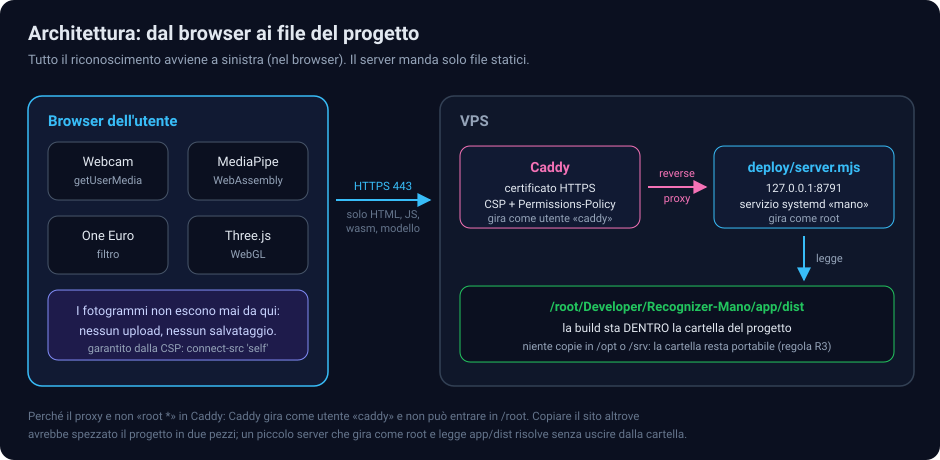
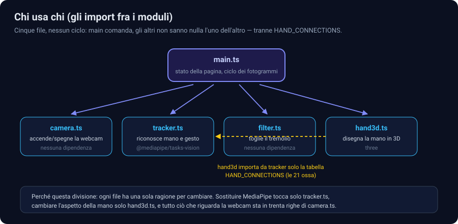
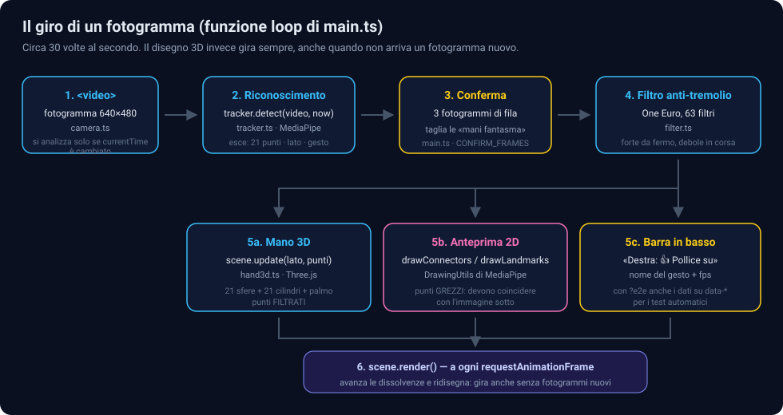
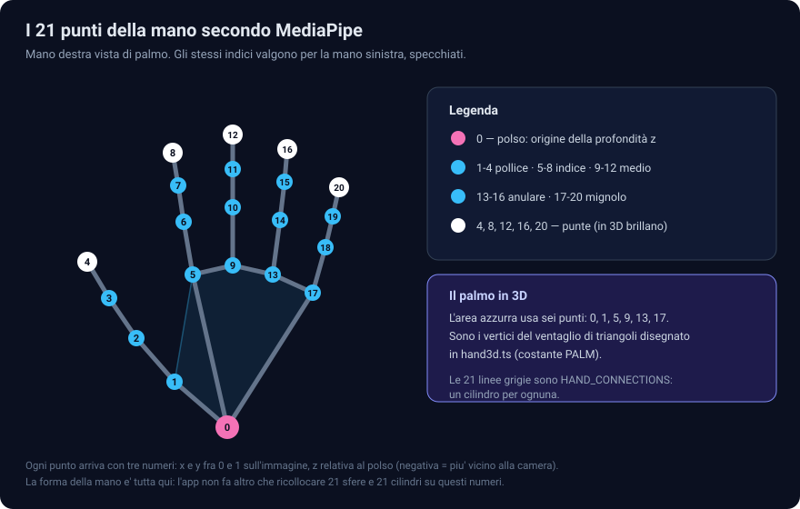
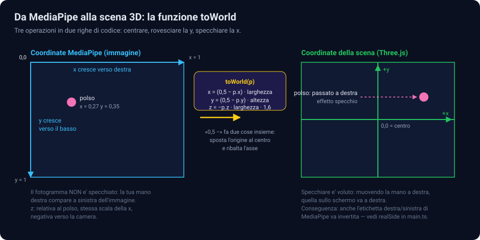
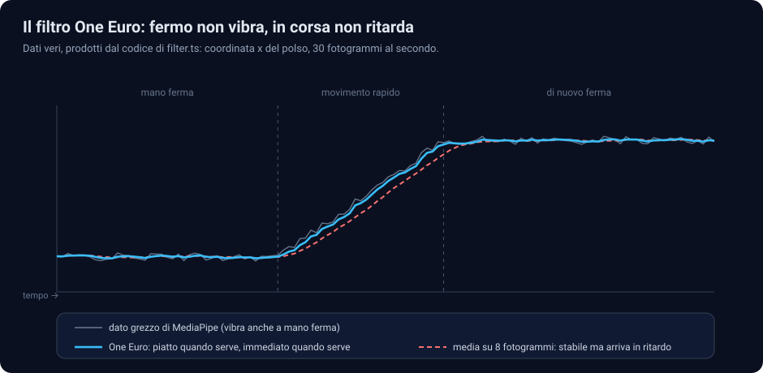
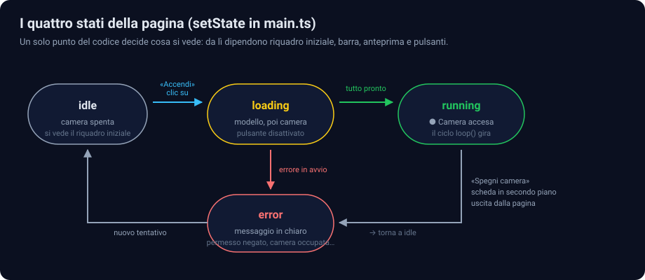
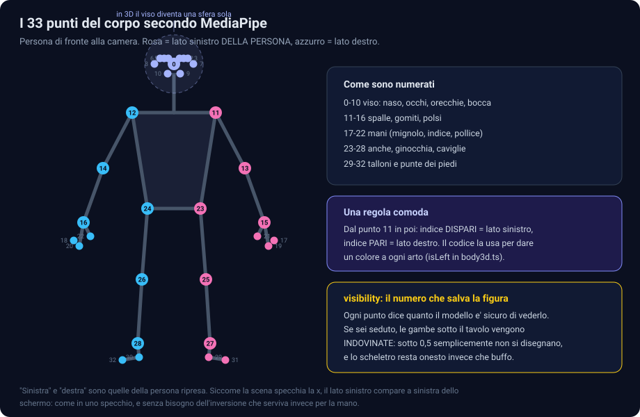
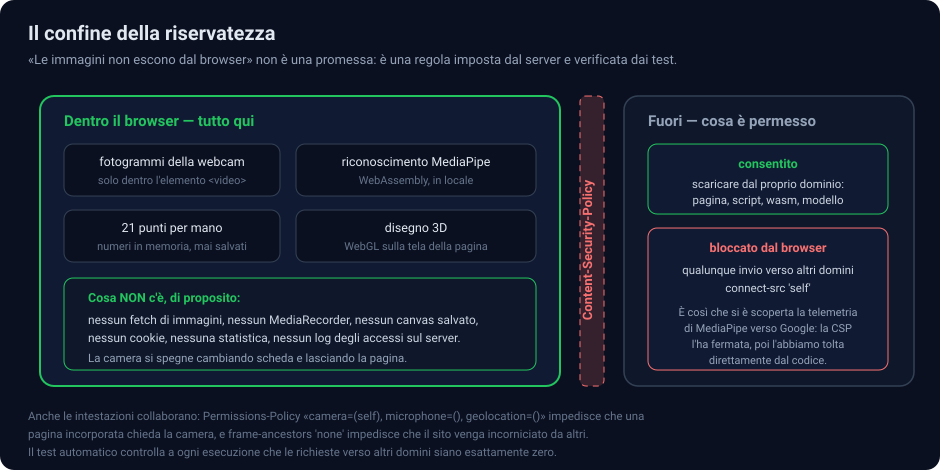
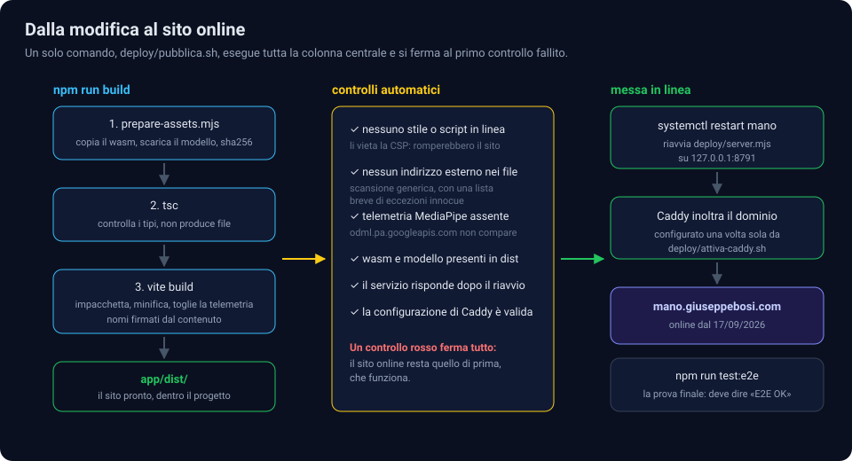

# Come funziona Recognizer-Mano

Documento di lettura, non di riferimento: spiega **tutto il codice del progetto, riga per riga
dove serve**, perché è scritto così e quali alternative sono state scartate.

Il codice sorgente è commentato in italiano: qui c'è il filo del discorso, là i dettagli.
I disegni sono in [`diagrammi/`](diagrammi/) e sono file SVG, quindi si possono aprire in un
browser e ingrandire quanto si vuole.

- Sito online: <https://mano.giuseppebosi.com> (dal 17 settembre 2026) — accesso con utente `123`
  e password `123`. Tre pagine: **`/`** la mano, **`/corpo/`** il corpo, **`/tutorial/`** la guida
  per costruirsi una cosa così da zero.
- Cartella del progetto: `/root/Developer/Recognizer-Mano` — tutto sta qui dentro, niente file sparsi altrove
- Diario dei lavori: [`JOURNAL.md`](JOURNAL.md) · ricerche: [`research/INDEX.md`](research/INDEX.md)

---

## Indice

1. [Cosa fa, in una frase](#1-cosa-fa-in-una-frase)
2. [Colpo d'occhio: l'architettura](#2-colpo-docchio-larchitettura)
3. [Le dipendenze, una per una, e il perché](#3-le-dipendenze-una-per-una-e-il-perché)
4. [La mappa dei file](#4-la-mappa-dei-file)
5. [Il giro di un fotogramma](#5-il-giro-di-un-fotogramma)
6. [I 21 punti della mano](#6-i-21-punti-della-mano)
7. [`camera.ts` — accendere una webcam senza sorprese](#7-camerats--accendere-una-webcam-senza-sorprese)
8. [`tracker.ts` — il riconoscimento](#8-trackerts--il-riconoscimento)
9. [`filter.ts` — il filtro anti-tremolio](#9-filterts--il-filtro-anti-tremolio)
10. [`hand3d.ts` — la mano in tre dimensioni](#10-hand3dts--la-mano-in-tre-dimensioni)
11. [`main.ts` — il regista](#11-maints--il-regista)
12. [L'interfaccia: `index.html`, `style.css`, `mano.css`](#12-linterfaccia-indexhtml-stylecss-manocss)
13. [La mano in 2D, e quanto costa davvero il 3D](#13-la-mano-in-2d-e-quanto-costa-davvero-il-3d)
14. [La sfida: sasso, carta, forbici in due](#14-la-sfida-sasso-carta-forbici-in-due)
15. [La pagina del corpo](#15-la-pagina-del-corpo)
16. [La pagina del tutorial](#16-la-pagina-del-tutorial)
17. [La pagina del corso](#17-la-pagina-del-corso)
18. [L'accesso: libero, con al massimo cinque persone insieme](#18-laccesso-libero-con-al-massimo-cinque-persone-insieme)
19. [La riservatezza, imposta e non promessa](#19-la-riservatezza-imposta-e-non-promessa)
20. [Come si costruisce e come va in linea](#20-come-si-costruisce-e-come-va-in-linea)
21. [Il test senza webcam](#21-il-test-senza-webcam)
22. [I problemi incontrati e come sono stati risolti](#22-i-problemi-incontrati-e-come-sono-stati-risolti)
23. [Ritocchi facili](#23-ritocchi-facili)
24. [Glossario](#24-glossario)

---

## 1. Cosa fa, in una frase

Apri il sito, premi **Accendi la camera**, muovi la mano davanti alla webcam: sullo schermo
compare una mano stilizzata — sfere alle articolazioni, bastoncini per le ossa, un palmo velato —
che segue la tua, dita comprese, e in basso il nome del gesto quando ne riconosce uno
(pugno, pollice su, vittoria…).

Sulla seconda pagina succede la stessa cosa con **tutto il corpo**: testa, braccia, busto e gambe
diventano uno scheletro stilizzato che ti imita (§13).

Tre cose, tutte decise all'inizio, spiegano quasi ogni scelta tecnica che segue:

1. **Deve girare nel browser, senza installare nulla.**
2. **Le immagini della webcam non devono lasciare il computer di chi guarda.**
3. **Tutto il progetto deve stare in una cartella e poter essere spostato altrove.**

---

## 2. Colpo d'occhio: l'architettura



Il lavoro vero — accendere la camera, riconoscere la mano, disegnarla — avviene **tutto nel
browser**. Il server fa una cosa sola: consegnare dei file.

La catena sul server ha un pezzo che di solito non serve, e che vale la pena spiegare:

```
internet → Caddy (HTTPS, intestazioni) → 127.0.0.1:8791 → deploy/server.mjs → app/dist/
```

Normalmente Caddy servirebbe i file da solo (`root * /percorso`). Qui non può: Caddy gira come
utente `caddy` e la cartella del progetto sta sotto `/root`, dove quell'utente non entra.
Le possibilità erano due:

| | copiare il sito in `/opt/mano` | un piccolo server che legge `app/dist` |
|---|---|---|
| Caddy legge i file | sì, direttamente | no, li chiede via proxy |
| pezzi del progetto fuori dalla cartella | **sì** | no |
| processi in più | nessuno | uno (~15 MB di RAM) |

La seconda colonna ha vinto per la regola numero 3: se domani il progetto va su un'altra
macchina, si copia una cartella e si riparte. Il "piccolo server" è
[`deploy/server.mjs`](../deploy/server.mjs): ottanta righe di Node, zero dipendenze.

---

## 3. Le dipendenze, una per una, e il perché

Il progetto ne ha **due** in produzione. Le altre servono solo a chi lavora al codice e non
finiscono nel sito.

### In produzione

**`@mediapipe/tasks-vision` 1.0.1** — il riconoscimento della mano.

È la libreria di Google che fa girare i suoi modelli di visione dentro il browser, compilati in
WebAssembly. Un solo modello dà sia i 21 punti della mano sia il nome di otto gesti.

*Perché questa*: le alternative erano TensorFlow.js con il modello handpose (più lento, e il
riconoscimento del gesto andrebbe scritto a mano) o un modello ONNX da far girare con
onnxruntime-web (più lavoro di montaggio, stesso risultato). MediaPipe è il riferimento del
settore per le mani, gira in locale e non costa nulla.

*Perché la versione è fissata esatta* (`1.0.1`, non `^1.0.1`): il modello e il runtime devono
combaciare, e la patch che disattiva la telemetria (§17) si appoggia su una stringa precisa del
file compilato. Un aggiornamento automatico romperebbe la build — e infatti è proprio quello che
si vuole: meglio una build che si ferma che una telemetria che si riaccende in silenzio.

**`three` 0.186.0** — il disegno 3D.

WebGL "nudo" significa scrivere shader, matrici di proiezione e gestione del contesto grafico:
centinaia di righe prima ancora di vedere una sfera. Three.js è la libreria standard per questo,
non ha dipendenze proprie, e tutta la scena di questo progetto sta in un file solo
(`hand3d.ts`, 300 righe commenti compresi).

*Perché non una libreria di grafica più leggera*: la scena usa luci, materiali che reagiscono
alla luce, trasparenze e una geometria costruita a mano. Sono esattamente le cose che Three.js
dà per fatte.

### Solo per lo sviluppo

| Pacchetto | A cosa serve | Perché proprio questo |
|---|---|---|
| `vite` ^8.3.0 | compila e impacchetta il sito | in sviluppo ricarica in un attimo; in produzione produce file statici con il nome firmato dal contenuto, che si possono mettere in cache per sempre |
| `typescript` ~6.0.2 | controlla i tipi | su codice pieno di coordinate e indici, un errore di battitura diventa un errore di compilazione invece di una mano storta |
| `@types/three` 0.186.0 | descrizioni dei tipi di Three.js | stessa versione della libreria, altrimenti descrive funzioni che non esistono |
| `playwright` 1.63.0 | guida un browser vero nei test | è l'unico modo di provare camera, WebAssembly, CSP e WebGL: fuori da un browser non esistono |

### Niente framework

Non c'è React, né Vue, né Svelte. L'interfaccia è fatta di **nove elementi** che cambiano stato
tutti insieme, in un punto solo del codice (la funzione `setState`). Un framework qui
aggiungerebbe un pacchetto, una fase di compilazione e un modello mentale in più per risparmiare
venti righe. Stesso ragionamento per il CSS: nessun Tailwind, 250 righe scritte a mano.

---

## 4. La mappa dei file

```
Recognizer-Mano/
├── CLAUDE.md, AGENTS.md      regole per gli assistenti che lavorano qui
├── PROJECT.md                stato del progetto in una pagina
├── bootstrap.sh              prepara l'ambiente su una macchina nuova
│
├── app/                      IL SITO (quattro pagine)
│   ├── index.html            /          la mano
│   ├── corpo/index.html      /corpo/    il corpo
│   ├── tutorial/index.html   /tutorial/ la guida, senza camera
│   ├── corso/index.html      /corso/    il corso in 10 lezioni, senza camera
│   ├── vite.config.ts        configurazione della build (+ patch telemetria)
│   ├── package.json          dipendenze e comandi
│   ├── scripts/
│   │   └── prepare-assets.mjs   porta dentro wasm e i quattro modelli di MediaPipe
│   ├── prova-scheletro.html  pagina di prova, solo in sviluppo: lo scheletro senza webcam
│   │                         (?turn= ?pitch= ?roll= ?jaw= ?face=0 ?hands=0)
│   ├── prova-testa.html      diagnosi, solo in sviluppo: posa del corpo e del volto a confronto
│   ├── src/
│   │   ├── main.ts           regia della pagina della mano
│   │   ├── corpo.ts          regia della pagina del corpo
│   │   ├── camera.ts         accensione/spegnimento webcam        (comune)
│   │   ├── filter.ts         filtro One Euro contro il tremolio   (comune)
│   │   ├── scene3d.ts        telecamera 3D, luci, coordinate      (comune)
│   │   ├── tracker.ts        MediaPipe: dai pixel ai 21 punti della mano
│   │   ├── pose.ts           MediaPipe: dai pixel ai 33 punti del corpo
│   │   ├── hands.ts          MediaPipe: le mani vere sulla pagina del corpo (e nella sfida)
│   │   ├── face.ts           MediaPipe: posa della testa e apertura della bocca (478 punti)
│   │   ├── mosse.ts          sasso, carta o forbici dalla forma delle dita, di palmo o di dorso
│   │   ├── voce.ts           la sintesi vocale del browser, per la sfida
│   │   ├── hand3d.ts         la mano stilizzata
│   │   ├── bones.ts          le forme delle ossa (cranio, mandibola, costole, bacino…)
│   │   ├── body3d.ts         lo scheletro umano: busto, arti, piedi, mani, luce
│   │   ├── skeleton-head.ts  la testa: cranio, mandibola mobile, collo, posa dal volto
│   │   ├── skeleton-utils.ts funzioni di servizio dello scheletro (assi, ossa fra due punti)
│   │   ├── style.css         l'aspetto comune del sito
│   │   ├── mano.css          lo schermo diviso della pagina della mano
│   │   ├── sfida.ts          l'arbitro di sasso-carta-forbici
│   │   ├── sfida.css         tabellone, cartelloni, istruzioni
│   │   ├── tutorial.css      l'aspetto della guida
│   │   ├── tutorial.ts       una riga: importa tutorial.css
│   │   ├── corso.css         l'aspetto del corso (compresa la stampa)
│   │   └── corso.ts          una riga: importa corso.css
│   ├── public/mediapipe/     wasm + i quattro modelli (generati, non si modificano a mano)
│   ├── dist/                 la build — è questo che il server pubblica
│   └── tests/e2e/            i test con le webcam finte (otto scenari: mano, sfida, onda…)
│
├── deploy/                   LA PUBBLICAZIONE
│   ├── server.mjs            server statico su 127.0.0.1:8791
│   ├── mano.service          modello dell'unità systemd
│   ├── Caddyfile.snippet     dominio, HTTPS, intestazioni, accesso con password
│   ├── attiva-caddy.sh       installazione, una volta sola
│   ├── aggiorna-caddy.sh     riallinea il blocco già installato al frammento
│   └── pubblica.sh           build + controlli + messa in linea
│
├── docs/                     QUESTO DOCUMENTO, i diagrammi e il diario
└── .claude/                  memoria, competenze e sub-agenti dell'ambiente agentico
```

E come si parlano i moduli delle due demo (guida e corso non ne usano nessuno):



---

## 5. Il giro di un fotogramma

È il cuore di tutto: la funzione `loop()` in `main.ts`.



```ts
function loop(): void {
  rafId = requestAnimationFrame(loop);      // richiamami prima del prossimo ridisegno
  const video = ui.video;
  if (tracker && video.readyState >= 2 && video.currentTime !== lastVideoTime) {
    lastVideoTime = video.currentTime;
    const now = performance.now();
    const result = tracker.detect(video, now);   // ← il riconoscimento
    …
  }
  scene.render();                            // ← il disegno, sempre
}
```

Tre dettagli che sembrano minuzie e non lo sono.

**`requestAnimationFrame` e non `setInterval`.** Il browser chiama `loop` appena prima di
ridisegnare lo schermo, quindi il disegno è sincronizzato con il monitor e, se la scheda cambia,
il ciclo rallenta da solo invece di consumare batteria di nascosto.

**`video.currentTime !== lastVideoTime`.** Lo schermo si aggiorna 60 volte al secondo, la webcam
ne produce 30: metà dei giri troverebbe lo stesso identico fotogramma. Analizzarlo due volte
sarebbe lavoro sprecato, e MediaPipe in modalità video rifiuta comunque due analisi con lo stesso
istante.

**`scene.render()` sta fuori dal `if`.** Il riconoscimento gira a 30 fotogrammi al secondo, il
disegno a 60: le dissolvenze delle mani che entrano ed escono restano fluide anche quando non
arriva niente di nuovo dalla camera.

Dentro il `if`, per ogni mano trovata, succedono cinque cose in fila:

```ts
let side = realSide(result.handedness[i]?.[0]?.categoryName);  // 1. di quale mano si tratta
if (seen.has(side)) side = side === "Right" ? "Left" : "Right";
seen.add(side);
streak[side]++;                                                 // 2. conferma

smoothers[side] ??= new LandmarkSmoother();
const smoothed = smoothers[side]!.smooth(landmarks, now);       // 3. filtro
if (streak[side] < CONFIRM_FRAMES) return;

scene.update(side, smoothed);                                   // 4. la mano 3D
drawing.drawConnectors(landmarks, HAND_CONNECTIONS, { … });     // 5. l'anteprima 2D
```

**Perché `realSide`.** MediaPipe dice "Left" o "Right" dando per scontato che l'immagine sia già
specchiata, come in una videochiamata. Il fotogramma grezzo della webcam non lo è, quindi
l'etichetta va ribaltata. Verificato il 17/09/2026 su una foto di mano sinistra dei test di
MediaPipe: la libreria rispondeva "Right".

**Perché la conferma su tre fotogrammi.** Nei cambi bruschi di immagine, MediaPipe ogni tanto
"vede" per un solo fotogramma una seconda mano che non c'è: nei test succedeva 2 volte su 117, e
sullo schermo era un lampo rosa fastidioso. Aspettare tre rilevazioni di fila l'ha azzerato,
al prezzo di un decimo di secondo di ritardo alla comparsa — che non si nota.

**Perché il filtro gira anche durante i fotogrammi di conferma.** Così, quando la mano finalmente
compare, è già stabile invece di assestarsi sotto gli occhi di chi guarda.

**Perché il 3D usa i punti filtrati e l'anteprima quelli grezzi.** Nell'anteprima i puntini
stanno sopra l'immagine della webcam: se fossero filtrati, si vedrebbero scivolare rispetto alle
dita vere. Nel 3D non c'è niente con cui confrontarli, e il filtro è puro guadagno.

---

## 6. I 21 punti della mano



Ogni punto arriva come tre numeri:

| | significato | intervallo |
|---|---|---|
| `x` | posizione orizzontale sull'immagine | 0 (bordo sinistro) … 1 (bordo destro) |
| `y` | posizione verticale | 0 (alto) … 1 (basso) |
| `z` | profondità **rispetto al polso** | stessa scala della `x`; negativa = più vicino alla camera |

La `z` è la coordinata meno precisa delle tre — è stimata da una sola telecamera — ma basta a
far capire che un dito è puntato in avanti.

E qui si passa al mondo 3D, che ha regole diverse:



```ts
toWorld(p: Point3): Point3 {
  const width = this.frameAspect * this.frameHeight;
  return {
    x: (0.5 - p.x) * width,              // centra E specchia
    y: (0.5 - p.y) * this.frameHeight,   // centra E rovescia (in 3D la y cresce in alto)
    z: -p.z * width * DEPTH_GAIN,        // verso l'osservatore, un po' esagerata
  };
}
```

Lo `0.5 -` fa due lavori in una sottrazione: sposta l'origine dall'angolo al centro
dell'immagine e inverte il verso dell'asse. Sulla `x` l'inversione è l'effetto specchio (muovi la
mano a destra, quella sullo schermo va a destra); sulla `y` è la conversione fra "y in giù" delle
immagini e "y in su" della grafica 3D.

`DEPTH_GAIN = 1.6` amplifica la profondità: senza, avvicinare la mano alla camera quasi non si
noterebbe. Il valore è scelto a occhio — più in alto la mano comincia a sembrare deformata.

---

## 7. `camera.ts` — accendere una webcam senza sorprese

Trenta righe, isolate apposta: è la parte che tocca i dati più delicati, e in un file piccolo
si controlla a colpo d'occhio che non ci sia nessun `fetch`, nessun `MediaRecorder`, nessun
salvataggio.

```ts
if (!window.isSecureContext || !navigator.mediaDevices?.getUserMedia) {
  throw new CameraError("La camera funziona solo su una pagina HTTPS.");
}
```

I browser danno accesso alla camera **solo** in "contesto sicuro": HTTPS oppure `localhost`.
Senza questo controllo, su `http://` l'app fallirebbe con un oscuro
`Cannot read properties of undefined`. È anche il motivo per cui questo progetto ha avuto bisogno
fin da subito di un dominio con certificato, e non poteva vivere su un indirizzo IP.

```ts
video: { facingMode: "user", width: { ideal: 640 }, height: { ideal: 480 } },
audio: false,
```

`ideal` e non `exact`: se la webcam non fa esattamente 640×480, il browser sceglie il formato più
vicino invece di rifiutare. 640×480 è un buon compromesso — MediaPipe non diventa più preciso con
immagini più grandi, ma diventa più lento. `audio: false` perché il microfono non serve: non va
nemmeno chiesto.

Gli errori del browser arrivano come `DOMException` con nomi standard, tradotti in frasi utili:

```ts
NotAllowedError     → "Permesso negato: consenti l'uso della camera…"
NotFoundError       → "Nessuna webcam trovata su questo dispositivo."
NotReadableError    → "La webcam è occupata da un'altra applicazione."
OverconstrainedError→ "La webcam non supporta la risoluzione richiesta."
```

Infine lo spegnimento, che è meno ovvio di quanto sembri:

```ts
stream?.getTracks().forEach((t) => t.stop());
video.pause();
video.srcObject = null;
```

Fermare il `<video>` **non** spegne la telecamera: il flusso resta aperto e la spia del portatile
resta accesa. Va fermata ogni singola traccia. È uno dei controlli del test automatico.

---

## 8. `tracker.ts` — il riconoscimento

Avvolge il `GestureRecognizer` di MediaPipe in una classe piccola che nasconde al resto dell'app
tre cose.

**Primo: da dove arrivano runtime e modello.**

```ts
const WASM_PATH = "/mediapipe/wasm";
const MODEL_PATH = "/mediapipe/gesture_recognizer.task";
```

Dal nostro dominio, non dalla CDN di Google come mostra la documentazione ufficiale. Due motivi:
la CSP del sito consente richieste solo verso il proprio dominio (§17), e la documentazione usa
l'indirizzo `@latest`, cioè "la versione di oggi" — il giorno che ne esce una nuova, il sito
cambierebbe da solo. Ci pensa `scripts/prepare-assets.mjs` a mettere i file al loro posto,
verificando il modello con il suo checksum:

```js
sha256: "97952348cf6a6a4915c2ea1496b4b37ebabc50cbbf80571435643c455f2b0482"
```

Se il file scaricato non corrisponde, la build si ferma.

**Secondo: scheda grafica o processore.**

```ts
if (forceCpu) return new HandTracker(…, "CPU");
try   { return new HandTracker(await GestureRecognizer.createFromOptions(vision, options("GPU")), "GPU"); }
catch { return new HandTracker(await GestureRecognizer.createFromOptions(vision, options("CPU")), "CPU"); }
```

Di norma la GPU è più veloce. Su alcune configurazioni succede il contrario, e in modo
spettacolare: nei test dentro un browser senza scheda grafica, la GPU emulata impiegava **3-5
secondi a fotogramma**, mentre la CPU ne faceva 4-6 al secondo. Per questo `main.ts` tiene
d'occhio i tempi e, se dopo 8 rilevazioni la media supera 150 ms, ricrea il riconoscitore su CPU:

```ts
if (!tracker || switching || tracker.delegate !== "GPU" || tracker.detections < 8 || tracker.avgDetectMs < 150) return;
```

Chi vuole forzare la scelta a mano può aggiungere `?delegate=cpu` all'indirizzo.

**Terzo: la regola dei tempi crescenti.**

```ts
const ts = now > this.lastTimestamp ? now : this.lastTimestamp + 1;
```

In modalità VIDEO MediaPipe usa l'istante per capire quanto tempo è passato dal fotogramma
precedente, e **interrompe con un errore** se riceve un tempo uguale o minore dell'ultimo.
Con `performance.now()` non dovrebbe mai capitare; il `+1` di sicurezza costa nulla ed evita un
errore fatale in un punto dove non ce lo si aspetta.

Le opzioni del riconoscitore:

```ts
runningMode: "VIDEO",             // "IMAGE" ripartirebbe da zero a ogni fotogramma
numHands: 2,
minHandDetectionConfidence: 0.5,  // per accorgersi che c'è una mano
minHandPresenceConfidence: 0.5,   // per dire che c'è ancora
minTrackingConfidence: 0.5,       // per continuare a seguirla senza ricercarla da capo
```

La differenza fra `VIDEO` e `IMAGE` non è cosmetica: in modalità video il modello **insegue** la
mano fra un fotogramma e l'altro, quindi è più veloce e più stabile. Le soglie a 0.5 sono quelle
consigliate da Google: alzarle riduce i falsi positivi ma fa "perdere" la mano più spesso.

Gli otto gesti riconosciuti, con le etichette mostrate nella barra in basso:

| modello | interfaccia |
|---|---|
| `Closed_Fist` | ✊ Pugno |
| `Open_Palm` | 🖐️ Mano aperta |
| `Pointing_Up` | ☝️ Indice in su |
| `Thumb_Down` | 👎 Pollice giù |
| `Thumb_Up` | 👍 Pollice su |
| `Victory` | ✌️ Vittoria |
| `ILoveYou` | 🤟 Ti voglio bene |
| `None` | nessuno dei precedenti → si mostra solo ✋ |

---

## 9. `filter.ts` — il filtro anti-tremolio

Il problema: anche con la mano perfettamente ferma, i punti che escono dal riconoscitore ballano
di qualche pixel a ogni fotogramma. Sullo schermo si vede una mano che vibra.

La cura ovvia — fare la media con i fotogrammi precedenti — toglie il tremolio ma introduce
ritardo: muovi la mano di scatto e quella sullo schermo arriva dopo. È il compromesso classico fra
stabilità e reattività, e non si può vincere con un filtro a forza fissa.

Il **One Euro filter** (Casiez, Roussel, Vogel, CHI 2012) lo aggira cambiando la propria forza in
base alla velocità del punto: filtra molto quando il punto è quasi fermo, poco quando corre.



Il grafico sopra è generato dal codice vero di `filter.ts`: nel primo tratto la linea azzurra è
piatta mentre il dato grezzo vibra; nel tratto in salita resta incollata al dato mentre la media
mobile (rossa tratteggiata) arriva visibilmente dopo.

Sono dodici righe di matematica:

```ts
const alpha = (cutoff: number, dt: number) => 1 / (1 + 1 / (2 * Math.PI * cutoff * dt));

filter(value: number, timeMs: number): number {
  const prev = this.x.last();
  const dt = this.lastTime === null ? 1 / 30 : Math.max((timeMs - this.lastTime) / 1000, 1e-3);
  this.lastTime = timeMs;

  const derivative = prev === null ? 0 : (value - prev) / dt;   // velocità del punto
  const edx = this.dx.filter(derivative, alpha(this.dCutoff, dt));  // velocità, a sua volta filtrata

  const cutoff = this.minCutoff + this.beta * Math.abs(edx);    // ← il cuore del metodo
  return this.x.filter(value, alpha(cutoff, dt));
}
```

`alpha()` tiene conto del tempo **realmente** trascorso fra due misure, così il filtro si comporta
allo stesso modo a 30 o a 60 fotogrammi al secondo. I tre parametri:

- `minCutoff = 1.2` — quanto filtrare a mano ferma: più basso, più stabile ma più lento;
- `beta = 8` — quanto "aprire" il filtro con la velocità: più alto, più insegue i movimenti rapidi;
- `dCutoff = 1` — filtro sulla stima della velocità, perché non saltelli.

Tarati a occhio sul risultato, sulle coordinate normalizzate di MediaPipe.

`LandmarkSmoother` mette un filtro indipendente su ogni coordinata: 21 punti × 3 assi = **63
filtri**, ognuno con due numeri di stato. Costa niente e tiene il codice banale. Un'istanza per
mano, creata quando la mano appare e buttata quando sparisce — altrimenti alla ricomparsa il
filtro "ricorderebbe" la posizione precedente e la mano arriverebbe strisciando da lì.

*Perché scritto in casa invece di installare una libreria*: sono trenta righe senza dipendenze, è
il filtro raccomandato nella letteratura sul tracciamento delle mani, ed è più facile da leggere
qui che nella documentazione di un pacchetto.

---

## 10. `hand3d.ts` — la mano in tre dimensioni

Il file trasforma 21 punti in una figura: **una sfera per articolazione, un cilindro per osso, un
poligono semitrasparente per il palmo**.

*Perché stilizzata e non una mano realistica*: un modello 3D vero andrebbe "vestito" su uno
scheletro (rigging e skinning), richiederebbe file pesanti da scaricare e molto lavoro di
rifinitura. Questa forma si costruisce con due geometrie e rende leggibile ogni dito.
Era anche quello che il committente aveva chiesto: «va bene anche in maniera stilizzata per
partire».

### L'idea che tiene tutto in piedi

Gli oggetti si creano **una volta sola** nel costruttore; a ogni fotogramma si spostano soltanto.

```ts
for (let i = 0; i < 21; i++) { const joint = new THREE.Mesh(jointGeo, …); this.group.add(joint); }
```

Creare e distruggere oggetti 60 volte al secondo farebbe lavorare di continuo il raccoglitore di
memoria, e si vedrebbe: scatti a intervalli irregolari. Per lo stesso motivo le geometrie sono
**condivise** — una sfera e un cilindro per l'intera scena, riusati da tutte le mani e da tutte le
ossa — e i vettori di lavoro sono allocati una volta:

```ts
private readonly world = Array.from({ length: 21 }, () => new THREE.Vector3());
```

### Come si piazza un osso

Ogni osso è un cilindro alto 1 e largo 1 che va portato da A a B. Tre operazioni:

```ts
dir.subVectors(b, a);
const len = dir.length();
bone.position.addVectors(a, b).multiplyScalar(0.5);                    // al punto medio
if (len > 1e-6) bone.quaternion.setFromUnitVectors(up, dir.divideScalar(len));  // ruotato su A→B
bone.scale.set(boneR, len, boneR);                                     // lungo quanto il segmento
```

`setFromUnitVectors(up, dir)` calcola la rotazione che porta l'asse Y (il verso naturale di un
cilindro in Three.js) sulla direzione voluta. Il controllo `len > 1e-6` evita una divisione per
zero quando due punti coincidono, cosa che capita nei primi fotogrammi.

Spessori e dimensioni **non** sono costanti: sono proporzionali alla distanza fra polso e nocca
del medio.

```ts
const size = this.world[0].distanceTo(this.world[9]);
const jointR = size * 0.075;
```

Così la mano resta credibile sia vicina alla camera (grande) sia lontana (piccola), senza che le
sfere sembrino palloni o spilli.

### Il palmo

Sei vertici (polso, base del pollice, le quattro nocche) e quattro triangoli a ventaglio:

```ts
palmGeo.setIndex([0, 1, 2,  0, 2, 3,  0, 3, 4,  0, 4, 5]);
this.palm.frustumCulled = false;
```

`frustumCulled = false` è una di quelle righe che salvano ore: i vertici cambiano a ogni
fotogramma, ma Three.js calcola il volume d'ingombro una volta sola. Senza quella riga, ogni tanto
decide che il palmo è fuori inquadratura e lo salta — e il palmo sparisce a intermittenza.

### Le dissolvenze

Tre materiali condivisi (ossa, punte, palmo) invece di uno per oggetto: cambiare la trasparenza di
un materiale la cambia per tutti gli oggetti che lo usano.

```ts
this.opacity += (this.targetOpacity - this.opacity) * Math.min(1, dt * 12);
```

`dt * 12` rende la dissolvenza indipendente dagli fps: circa un decimo di secondo su qualunque
macchina. Quando l'opacità arriva a zero il gruppo diventa invisibile e Three.js lo salta del
tutto.

### Luci e inquadratura

```ts
new THREE.HemisphereLight(0xdbeafe, 0x1e1b4b, 1.4);  // diffusa cielo/terra: niente ombre nere
const key = new THREE.DirectionalLight(0xffffff, 2.2); key.position.set(3, 5, 8);   // dà volume
const rim = new THREE.DirectionalLight(0x818cf8, 1.2); rim.position.set(-4, -2, -6); // stacca dallo sfondo
```

La telecamera virtuale è **ferma** a `z = 10` e guarda l'origine: si muove la mano, non
l'inquadratura. È ciò che rende immediato l'effetto specchio.

`resize()` calcola quanto mondo entra nell'inquadratura e adatta l'area-video, scegliendo il lato
che stringe di più. Sul telefono in verticale c'è un ritocco:

```ts
const zoom = Math.min(1.4, Math.max(1, this.frameAspect / this.camera.aspect));
```

Senza, la mano risulterebbe minuscola in mezzo a due bande vuote; con l'ingrandimento (massimo
1,4×) si accetta che vicino ai bordi laterali possa uscire dall'inquadratura.

---

## 11. `main.ts` — il regista

Qui non c'è quasi nessun calcolo: si mettono in fila gli altri quattro moduli e si gestisce lo
stato della pagina.



```ts
function setState(state: State, status: string): void {
  document.body.dataset.state = state;
  ui.status.textContent = status;
  ui.status.classList.toggle("live", state === "running");
  ui.intro.hidden = state === "running";
  ui.hud.hidden = state !== "running";
  ui.preview.hidden = state !== "running" || ui.togglePreview.getAttribute("aria-pressed") !== "true";
  ui.start.disabled = state === "loading";
  ui.start.textContent = state === "loading" ? "Avvio in corso…" : "Accendi la camera";
}
```

Un solo punto decide cosa si vede. È la funzione più noiosa del progetto ed è anche quella che
evita la classe di bug più comune in un'interfaccia: due elementi che raccontano stati diversi.

### L'ordine dell'avvio

```ts
tracker ??= await HandTracker.create();   // prima il modello (8 MB)
stream = await startCamera(ui.video);     // poi la camera
```

Prima il modello, poi la webcam. Così il permesso viene chiesto quando manca poco al via, e non
si tiene la telecamera accesa per secondi mentre si scarica il modello. Il `??=` fa sì che alla
seconda accensione il modello già in memoria venga riusato: si riparte all'istante.

### Le tre attenzioni sulla riservatezza

```ts
if (document.hidden) { stop(); return; }                       // scheda già in secondo piano
document.addEventListener("visibilitychange", () => { if (document.hidden && stream) stop(); });
window.addEventListener("pagehide", () => { stop(); tracker?.close(); tracker = null; });
```

Sono nate da un controllo fatto apposta su questo codice: cambiando scheda subito dopo aver dato
il permesso, la camera restava accesa in secondo piano.

### La dissolvenza dopo lo spegnimento

```ts
let n = 20;
const fade = () => { scene.render(); if (--n > 0) requestAnimationFrame(fade); };
fade();
```

Il ciclo principale è fermo, ma la mano ci mette un decimo di secondo a svanire: venti fotogrammi
di disegno in più e la sparizione resta morbida invece di essere un taglio netto.

### La porta di servizio per i test

```ts
const E2E = new URLSearchParams(location.search).has("e2e");
…
if (E2E) { document.body.dataset.hands = …; document.body.dataset.wrist = …; }
```

Con `?e2e` la pagina scrive nel DOM quello che sta vedendo, così il test automatico può
verificarlo. **Fuori dai test è spento di proposito**: sono pur sempre dati sulla mano di chi usa
il sito, e qualunque estensione del browser potrebbe leggerli dalla pagina.

---

## 12. L'interfaccia: `index.html`, `style.css`, `mano.css`

La pagina è a **schermo diviso**: da una parte quello che vede la webcam, dall'altra la mano
ricostruita. Fino al 29/09/2026 la webcam era un riquadrino da 240 px in basso a destra, e si
capiva a malapena cosa stesse guardando il riconoscitore.

```
<header class="topbar">  marchio + navigazione + stato della camera
<main class="split">     i due pannelli, affiancati (uno sopra l'altro sotto gli 860 px)
  <section class="pane preview">   video + puntini + avviso "avvicinati"
  <section class="pane">           <canvas id="scene">, la mano 3D
<section class="intro">  riquadro iniziale con il pulsante, sovrapposto al centro
<footer class="hud">     gesti, fps, pulsanti           (solo a camera accesa)
```

Due vincoli nascosti, imposti dalla CSP di produzione: **nessuno `<script>` scritto dentro la
pagina** e **nessun attributo `style=""`**. Li vieta il server, e `deploy/pubblica.sh` si rifiuta
di pubblicare una build che li contiene.

Sull'`<video>` ci sono tre attributi che sembrano decorativi e non lo sono:
`muted` e `playsinline` (senza, iOS rifiuta di riprodurre il video in pagina) e `autoplay`.

Nel CSS la regola non banale è il pannello della camera:

```css
.preview video, .preview canvas { object-fit: contain; transform: scaleX(-1); }
```

Il ribaltamento è **solo visivo** — serve a far sembrare l'immagine uno specchio. I numeri che
arrivano da MediaPipe restano quelli della ripresa vera, ed è esattamente per questo che `main.ts`
deve invertire destra e sinistra. `contain` e non `cover`: nel riquadrino da 240 px ritagliare i
bordi era accettabile, ma ora quel pannello serve proprio a capire cosa resta **fuori**
inquadratura, e tagliarlo sarebbe controproducente.

**Due fogli di stile, non uno.** `style.css` è il vestito comune del sito e lo usano anche
`/corpo/` e `/mano2d/`; `mano.css` contiene solo lo schermo diviso e **sovrascrive** le regole
della vecchia anteprima galleggiante invece di modificarle, perché cambiarle in `style.css`
romperebbe `/corpo/`, che quella anteprima piccola ce l'ha ancora.

L'impaginazione è una griglia a tre righe (`auto 1fr auto`: barra, pannelli, comandi) e non più
elementi in `position: fixed` con le altezze scritte a mano. Il motivo è concreto: con sei voci nel
menu la barra in alto passa da 54 a 82 px su un telefono, e ogni numero fissato a mano tagliava
qualcosa. I due pannelli usano `grid-auto-flow: column` + `grid-auto-columns: 1fr`, così le colonne
le conta il browser sui figli **visibili**: quando l'utente nasconde la camera, la mano 3D si
prende tutta la larghezza da sé.

### Il pulsante «Schermo intero» (06/10/2026)

Su tutte le pagine con la camera (Mano, Sfida, Onda, Corpo) c'è un pulsante in alto a destra, accanto
allo stato della camera: un clic mette la pagina a schermo intero, **lo stesso pulsante** (che diventa
«Esci da schermo intero»), il tasto Esc o la lettera F la riportano com'era. Sta in alto e non nella
barra dei comandi perché così è visibile sempre, anche prima di accendere la camera e anche a
schermo intero. È `src/schermo-intero.ts`, sulla Fullscreen API del browser; dove non esiste (l'iPhone
non la offre alle pagine web) il pulsante si nasconde.

Per sfruttare *tutto* il monitor non basta ingrandire: l'`<html>` prende la classe `schermo-intero` e i
CSS nascondono il menu, tolgono i margini e fanno **galleggiare** le due barre sopra l'immagine,
semitrasparenti. Misurato sulla sfida a 1280×800: in finestra l'immagine era 1248×670; con le barre
lasciate nel flusso a schermo intero diventava 1280×704 (+5%, il difetto del primo tentativo); con le
barre sovrapposte occupa 1280×800. Le scritte in basso (istruzioni, suggerimento, avviso) salgono sopra
la barra dei comandi. La pagina della mano resta divisa in due pannelli: l'immagine della camera
prende metà larghezza, perché è un video 4:3 e la sua misura è limitata dalla larghezza.

### L'avviso «avvicina la mano»

La pagina misura il **palmo** — la distanza fra il polso (punto 0) e la nocca del medio (punto 9) —
e se è troppo corto mostra un avviso sul pannello della camera. Il palmo e non il riquadro che
contiene i 21 punti: quel riquadro si dimezza a pugno chiuso, il palmo no.

L'unità è "quanta parte dell'altezza dell'immagine", e la x va moltiplicata per le proporzioni del
video: le x di MediaPipe sono divise per la larghezza e le y per l'altezza, quindi senza quella
correzione la stessa mano darebbe numeri diversi su una webcam 4:3 e una 16:9.

La soglia è **misurata**, non scelta a occhio. La stessa foto, messa dentro un fotogramma 640×480 a
quattro dimensioni diverse per simulare la distanza:

| la mano occupa | palmo misurato | rilevata |
|---|---|---|
| 100% dell'altezza | 0,345 | 108/110 |
| 60% | 0,204 | 86/88 |
| 40% | 0,136 | 102/104 |
| 28% | 0,093 | 79/81 |

Da notare l'ultima colonna: **MediaPipe la trova lo stesso anche piccola**. Il problema non è che
smetta di funzionare, è che a quel punto le dita sono pochi pixel e la mano 3D diventa imprecisa.
La soglia (0,115, cioè circa un terzo del fotogramma) è quindi una scelta di comodità, non un
limite tecnico.

Le soglie sono **due** — si accende sotto 0,115 e si spegne solo sopra 0,13, dopo 5 fotogrammi di
conferma: con una sola, una mano ferma sul confine farebbe lampeggiare l'avviso.

Lo scenario e2e `mano-lontana` lo verifica con un filmato costruito apposta (`hand-far.mjpeg`):
tutte le foto di prova di MediaPipe sono ravvicinate, quindi un caso "mano lontana" non esisteva.

---

## 13. La mano in 2D, e quanto costa davvero il 3D

La pagina `/mano2d/` (costruita il 23/09/2026 ed **eliminata il 29/09/2026** su richiesta di
Giuseppe; il codice non c'è più, la misura sì) faceva la stessa cosa della pagina principale, tolta
la profondità: i 21 punti e le ossa disegnati **direttamente sopra l'immagine** della webcam, su
una tela 2D.

Esiste per rispondere a una domanda concreta — *quanto pesa il 3D?* — e la risposta, misurata sul
nostro codice:

| | pagina 3D (`/`) | pagina 2D (`/mano2d/`) |
|---|---|---|
| accendere la camera | `camera.ts`, 69 righe | `camera.ts`, 69 righe — **identico** |
| riconoscere la mano | `tracker.ts`, 121 righe | `tracker.ts`, 121 righe — **identico** |
| disegnare | `hand3d.ts` 187 + `scene3d.ts` 127, più Three.js | `drawConnectors` + `drawLandmarks`: **due chiamate** |

Cioè 314 righe e una dipendenza in meno, e soprattutto un vocabolario in meno: scena, telecamera
virtuale, luci, materiali, geometrie, quaternioni. In 2D le coordinate che arrivano da MediaPipe
sono già quelle giuste — `x` e `y` vanno da 0 a 1, si moltiplicano per larghezza e altezza della
tela e sono pixel. La `z`, che non è una misura vera, qui non serve proprio.

**Quello che non si semplifica** è tutto ciò che viene prima del disegno, ed è il motivo per cui
i due file sopra sono importati senza una riga di differenza.

Manca di proposito anche il filtro anti-tremolio: in 3D serve perché la mano fluttua nel vuoto e il
tremolio si nota, qui i punti sono incollati all'immagine sotto e un filtro li farebbe solo
arrivare in ritardo rispetto al video.

---

## 14. La sfida: sasso, carta, forbici in due

`/sfida/` è un gioco per **due persone davanti alla stessa webcam**, una mano a testa. Si conta
«tre, due, uno, via!», un secondo e mezzo dopo la pagina guarda le due mosse, assegna il punto;
**primo a 2 vince** (era 5, poi 3). Una voce — la sintesi vocale del browser — dice l'inizio, il
conto, il punto e il vincitore.

### Le mosse si leggono dalla forma delle dita, non dal nome del gesto

Alla prima versione le mosse erano tre dei gesti che MediaPipe sa nominare (`Closed_Fist`,
`Open_Palm`, `Victory`). Funzionava, ma il classificatore è addestrato soprattutto su mani viste dal
**palmo**: una mano girata di 180° può essere scambiata per un altro gesto o per nessuno. Per un
gioco in cui ognuno tiene la mano come gli viene comoda non bastava.

`src/mosse.ts` guarda invece quali dita sono distese e quali piegate, con una proporzione fra due
distanze nello stesso fotogramma: la punta di ogni dito lungo rispetto al polso, divisa per la sua
nocca rispetto al polso. Non dipende da quanto è lontana la mano, né da quale lato si guarda.

| | rapporto misurato | |
|---|---|---|
| dito disteso | 1,78 – 2,29 | soglia ≥ 1,55 |
| dito piegato | 0,62 – 0,84 | soglia ≤ 1,35 |

Fra le due soglie c'è un vuoto largo: una mano a metà è dichiarata *incerta* invece di essere
spinta da una parte. Il pollice si ignora (nel sasso sta dentro o fuori a seconda di chi lo fa).

| mossa | le quattro dita lunghe |
|---|---|
| sasso ✊ | tutte piegate |
| carta ✋ | tutte distese |
| forbici ✌️ | indice e medio distesi, anulare e mignolo piegati |

Qualunque altra combinazione (solo l'indice, tre dita) non è una mossa e il round si ripete.
**Verificato su mani di palmo e di dorso**: `right_hands.jpg` ritrae due mani aperte, una vista dal
dorso, e le legge entrambe come carta (rapporti 2,05–2,29); lo scenario `sfida-dorso` lo dimostra.
Sasso e forbici di dorso NON sono stati provati su foto reali (non ce ne sono fra quelle
pubbliche di MediaPipe): la regola è la stessa e non dipende dal lato, ma la prova manca.

### Le tre cose che rendono il gioco onesto

**1. Chi è il giocatore 1.** Non si usa l'etichetta destra/sinistra del modello: quella la decide
MediaPipe dando per scontato di vedere **una** persona allo specchio, e qui le persone sono due.
Si usa la posizione orizzontale del polso sullo schermo — una misura, non un'ipotesi. È la stessa
lezione già imparata sulla pagina del corpo.

Attenzione al ribaltamento: l'immagine è specchiata, quindi una mano che nel fotogramma della
webcam sta a destra, sullo schermo compare a sinistra. Senza `1 - x` i due giocatori si
scambierebbero i punti, ed è il tipo di errore che nessuno nota finché non litigano.

**2. Quando si "tira".** Leggere il gesto in un istante solo vorrebbe dire affidarsi a un
fotogramma: basterebbe una mano a mezz'aria fra due mosse per assegnare il punto sbagliato. Si
guarda invece una finestra di 600 ms e si prende la mossa **più frequente** di ciascuno.

E non la si guarda subito: dopo il «via!» si aspetta **un secondo e mezzo** (compare «Mostrate la
mossa!», poi «Fermi così!»). Chi tira ha bisogno di un momento per formare la mossa, e leggere le
mani mentre cambiano forma vuol dire leggerle a metà strada fra due gesti.

**3. Se una mano esce** durante il conto alla rovescia, il round si annulla invece di assegnare un
punto a caso.

### La macchina a stati

```
attesa ─due mani 0,5 s─▶ [intro, solo a inizio partita] ─▶ conto ─3,2,1─▶ rivelazione ─▶ esito
   ▲                                                         │      (via + 1,5 s + 0,6 s)  │
   └────────────────── round annullato ──────────────────────┘                             │
   └──────────────────── dopo 1,8 s (3,4 s con la voce), se nessuno è a 2 ─────────────────┘
                                                                                            ▼
                                                                                          fine
```

### La voce

`src/voce.ts` usa `speechSynthesis`, l'API del browser: niente librerie né file audio. Tre cose da
sapere. **Non è garantita**: un browser può non avere nessuna voce italiana (Chromium senza testa,
nelle prove, non ne ha); allora il gioco funziona identico, perché tutto ciò che si dice è anche
scritto a schermo. **Si preferisce una voce locale** (`voice.localService`): alcune voci dei browser,
per esempio quelle Google di Chrome, inviano il testo a un server per farlo leggere. Il testo qui è
solo frasi fisse del gioco («tre», «punto al giocatore di destra», «ha vinto…») e mai niente che
venga dalla camera, ma una voce sul dispositivo è più pulita e si sceglie quando c'è. **Parte solo
dopo un clic** (il pulsante «Accendi la camera»), come impongono i browser. Il pulsante «Voce» in
basso la spegne.

I numeri del conto si dicono una volta sola, quando compaiono, e interrompono quello che si sta
dicendo; il punteggio e il vincitore invece si lasciano finire. Se un punto chiude la partita non si
dice niente subito: tocca alla frase del vincitore, che comprende il punteggio, perché due frasi una
sopra l'altra si tagliano. Per questo la fase di esito dura 3,4 secondi con la voce e 1,8 senza.

### Provarlo senza due persone

Il filmato finto `duel.mjpeg` affianca due foto di mani nello stesso fotogramma. Alla prima prova
erano larghe 400 px in un fotogramma da 640: si sovrapponevano, il pugno restava tagliato a metà e
il riconoscitore vedeva **una mano sola** — il test diceva solo «1 mano in campo» senza spiegare
perché, e il motivo si è visto soltanto estraendo il fotogramma e guardandolo.

Lo scenario e2e gioca una partita intera e pretende che finisca **0-2**. Quel punteggio non è un
capriccio: protegge il ribaltamento dei lati, che è facilissimo invertire senza accorgersene.

### L'onda energetica (`/onda/`)

Una seconda pagina costruita sullo stesso schema della sfida, ispirata all'onda di Goku: si
uniscono le mani davanti alla webcam, fra le mani nasce una palla di luce, e se la posa viene
**tenuta 4 secondi** parte un raggio. Il riconoscimento è quello di sempre (`tracker.ts`, due mani,
21 punti ciascuna): quello che c'è di nuovo sono un **giudice della posa**, una **macchina a stati**
(`src/onda.ts`) e gli **effetti di luce** (`src/onda-fx.ts`), disegnati a mano su una tela 2D senza
nessuna libreria in più.

**La posa si giudica su quattro misure**, tutte calcolate dai 21 punti e in unità d'altezza (la x di
MediaPipe va moltiplicata per le proporzioni del video, altrimenti la stessa mano darebbe numeri
diversi su una webcam 4:3 e su una 16:9):

| misura | soglia per entrare / restare | misurato sul filmato di prova |
|---|---|---|
| distanza fra i polsi ÷ scala della mano (la maggiore fra lunghezza e larghezza del palmo) | ≤ 1,6 / ≤ 2,0 | **0,4–1,06** (mani vicine), 2,42 (mani staccate) |
| dita stese **sommando le due mani** (su 8, pollice escluso) | ≥ 4 / ≥ 3 | 8 |
| angolo fra le direzioni delle dita | ≤ 135° / ≤ 160° | 28° in parallelo, **87° a ventaglio** |
| lunghezza polso→punta ÷ palmo | ≥ 1,0 (sotto: scorcio, raggio in orizzontale) | ~1,9 |

Le soglie sono **due per ogni misura**: con una sola, una mano ferma sul confine entrerebbe e
uscirebbe dalla posa a ogni fotogramma e la carica non finirebbe mai.

**La posa vera è un ventaglio, non due mani parallele (04/10/2026).** Alla prima versione la pagina
chiedeva dita nello stesso verso (≤ 75°) e almeno tre dita stese **per mano**. Una persona vera, che la
provava con le mani puntate verso la camera — una con le dita in su, l'altra di lato, a ~100° — veniva
scartata: la sua posa non partiva. Tre correzioni, tutte misurate: (1) l'angolo massimo sale a 135°/160°
(ora scarta solo mani in versi opposti) e non si giudica per niente se una mano punta quasi verso la
camera, perché la sua direzione nel piano è rumore; (2) le dita stese si **sommano** sulle due mani (≥ 4
su 8): una mano a coppa o scorciata ne ha poche, e due pugni continuano a non passare; (3) la distanza
fra i polsi si divide per la **larghezza** del palmo se è maggiore della lunghezza, perché puntando la
mano verso la camera la lunghezza si accorcia e due polsi che si toccano sembrerebbero lontani. Prova:
il filmato `ventaglio-mobile.mjpeg` (angolo misurato 87°, che la vecchia soglia di 75° scartava) e lo
scenario `onda-ventaglio`.

**Il raggio segue le mani per tutta la sua durata**, anche fuori dalla posa: prima, una volta sparato,
si fermava se la posa non reggeva più e restava dov'era mentre le mani si spostavano. Misurato con le
mani che scorrono: l'origine del raggio si sposta di 95–107 px.

La scritta della carica è «ONDA ENERGETICA» (prima «KA-ME-HA-ME-HA»), completata in cinque passi sui 4
secondi, e allo sparo «ONDA ENERGETICA!!!». Più lunga della vecchia, usciva dallo schermo: la misura
segue la larghezza (`vw`).

**Il suono (`src/onda-audio.ts`, dal 06/10/2026).** Nessun file audio e nessuna libreria: il suono è
**sintetizzato al momento** dalla Web Audio API (oscillatori, rumore, filtri). Per questo la CSP non
cambia, pesa zero byte, e soprattutto **segue la carica passo passo** — un file registrato dura quanto
dura, qui altezza, luminosità e battito dipendono da quanto la posa è stata tenuta. Quattro strati:

1. **La carica** è un ronzio basso (due dente-di-sega leggermente stonate e un sub) che *sale*:
   l'altezza raddoppia circa e il filtro si apre da cupo a brillante; un **battito** (un LFO sul
   volume) accelera da 1,3 a ~9 colpi al secondo; sotto, un soffio di rumore che «risucchia» (un
   passa-banda che sale) e in cima un cristallino con tremolo sempre più rapido.
2. **Lo sparo** è un colpo: un sub che cade da 150 a 32 Hz in 0,8 s (il «boom»), una sferzata di rumore
   che si chiude da acuta a cupa, un crepitio secco.
3. **Il raggio** è un ruggito continuo (due dente-di-sega a quinta più un quadro all'ottava sotto,
   passati in un saturatore `tanh` e un filtro) con un velo d'aria. Segue la posizione del raggio:
   il **pannello stereo** lo porta a sinistra o a destra dello schermo mentre si muovono le mani — con la
   x specchiata, perché lo schermo è uno specchio. Si spegne con la coda visiva del raggio.
4. **Lo spazio**: un riverbero breve (rumore con decadimento esponenziale) e un **compressore** sul
   master, perché lo sparo è tanto più forte della carica che senza freno farebbe saltare chi ha il
   volume alto.

Se le mani spariscono la carica non si spegne in dissolvenza: **si strappa** (un fischio che precipita),
come la palla sullo schermo.

*Come si è fatta la taratura senza poter ascoltare.* Il modulo non sa niente di DOM né di tempo reale:
riceve un contesto audio e un istante. Con un `OfflineAudioContext` (`prova-suono.html`, solo in
sviluppo) lo si **renderizza in un file** e lo si misura: volume e luminosità per finestra, clipping,
bilanciamento sinistra/destra, spettrogramma. Il primo rendering ha mostrato due difetti che a
orecchio non si sarebbero visti subito: lo sparo non era più forte della carica al massimo (RMS 0,199
contro 0,213 — ma metà del confronto era sbagliato, perché la finestra della «carica» conteneva già
lo sparo: rimisurata prima, la carica è a 0,13 e lo sparo a 0,25) e il raggio aveva una luminosità di
7600 Hz, cioè era un sibilo e non un ruggito (il velo d'aria era a 0,12; a 0,03 il centroide scende a
~3400 Hz). Risultato finale: nessun clipping (picco 0,79), carica 0,06 → 0,13, sparo 0,25, raggio
0,25, coda 0,03, strappo seguito dal silenzio.

*Regole che non si possono aggirare.* L'audio parte **dentro il clic** su «Accendi la camera» (i
browser vietano l'audio prima di un gesto dell'utente), c'è il pulsante **«Suono»** per spegnerlo
(l'avviso sul volume sta già nella scheda iniziale: lo sparo è forte), e a camera spenta il contesto
si **sospende** (e il suono si zittisce subito). Se il browser non ha la Web Audio API la pagina
funziona identica, muta. Lo scenario e2e legge `data-suono` (stato del motore e livelli): carica
0,13 → 0,41, sparo → ruggito a 0,60.

**La macchina a stati**

```
idle ──posa tenuta 0,3 s──▶ carica ──4 s──▶ raggio ──2,5 s──▶ riposo
  ▲                           │ posa persa: la carica SCENDE al doppio della velocità con cui sale;
  │                           │ se arriva a zero si ricomincia
  └──── mani sciolte per 0,6 s ◀────────────────────────────────────┘
```

- **Se una mano esce dall'inquadratura l'onda SPARISCE** (dal 04/10/2026), non scende piano: la
  carica va a zero e la palla non c'è più; lo stesso per il raggio, che finisce. Resta solo una
  tolleranza di 0,15 s per i fotogrammi persi dal riconoscitore. Il calo graduale (al doppio della
  velocità di salita) vale ancora quando le mani **si vedono ma escono dalla posa** (polsi
  staccati, pugni), con la tolleranza qui sotto. Scenario `onda-sparisce`: carica a 0,71, subito a 0.
- **Tolleranza di 0,4 s**: il riconoscitore ogni tanto perde le mani per un fotogramma, e senza
  perdono 3 secondi e mezzo di carica andrebbero persi per uno starnuto del modello. Provato con un
  filmato in cui le mani si staccano per un secondo: la carica passa da 0,61 a 0,28 e poi risale,
  e lo sparo arriva circa 2 secondi dopo il momento in cui sarebbe arrivato.
- **Dopo lo sparo bisogna sciogliere le mani** prima di poter ricaricare; altrimenti, tenendole
  ferme, il raggio ripartirebbe da solo ogni 6 secondi.
- **Il tempo della macchina a stati è il tempo vero**, senza tetto: su un computer che disegna 4
  fotogrammi al secondo la carica dura comunque 4 secondi. Il tetto (0,05 s) vale solo per la fisica
  delle particelle, altrimenti un salto di secondi le catapulterebbe fuori schermo.
- **Riconoscimento ed effetti vanno separati**: il riconoscimento gira quando arriva un fotogramma
  dalla webcam (30 al secondo, o 4 su un computer lento), gli effetti si ridisegnano a ogni
  `requestAnimationFrame` interpolando fra le ultime posizioni note.

**Come è fatta la luce.** `globalCompositeOperation = "lighter"` *somma* i colori invece di coprirli:
due bagliori che si sovrappongono diventano più luminosi, come la luce vera. La palla sono quattro
gradienti radiali (alone, alone interno, nucleo, centro) più qualche fulmine; le scintille che
vengono risucchiate dalla palla sono segmenti che accelerano verso il centro; il raggio è un
**poligono con un profilo di larghezza** (stretto alla base, pieno poco dopo, coda che si affina) e
non una linea spessa — con una linea ogni strato aveva la testa tonda e il raggio sembrava una
pillola azzurra. Niente `shadowBlur`: sfocare un'ombra costa moltissimo, un gradiente radiale no.
I fulmini usano un generatore casuale **a seme** che cambia 12 volte al secondo: a 60 volte al
secondo sfarfallerebbero, e per chi è sensibile alle luci sarebbe pericoloso.

**Sicurezza per chi è sensibile alle luci.** Un solo lampo allo sparo, che svanisce in un quarto di
secondo (le linee guida WCAG 2.3.1 vietano più di tre lampeggi al secondo); avviso in cima alla
scheda iniziale; con `prefers-reduced-motion` niente scossa, pulsazioni quasi ferme e lampo ridotto
a un velo.

**Limite noto, da non nascondere.** Dalla sola immagine 2D **non si può sapere se i palmi guardano la
camera**: la posa riconosciuta è «due mani aperte, unite, con le dita nello stesso verso», e va bene
sia con i palmi sia con i dorsi. È una posa di mani, non un'analisi di come sono ruotate. Se le dita
puntano verso la camera la direzione 2D non è affidabile (scorcio) e il raggio parte in orizzontale
verso il lato dello schermo con più spazio.

**Come si prova senza webcam.** `onda.mjpeg` affianca la mano destra di `right_hands.jpg` e la sua
gemella specchiata, con i polsi vicini e i pollici all'esterno; `onda-lontane.mjpeg` è la stessa
coppia staccata, ed è il negativo che **isola** la soglia sulla distanza (con il pugno e la vittoria
della sfida il test passerebbe anche a soglia rotta, perché lì le dita aperte mancherebbero
comunque). Gli scenari `onda` e `onda-lontane` pretendono, tra l'altro, che la posa venga tenuta
fra 3,6 e 5,2 secondi prima dello sparo (`data-tenuta`, solo con `?e2e`).

---

## 15. La pagina del corpo

La pagina `/corpo/` fa la stessa cosa della prima, ma su tutta la persona: testa, braccia, busto,
gambe e mani, riprodotti come uno **scheletro umano** — cranio, colonna, gabbia toracica, bacino,
ossa lunghe con le loro teste, falangi.



### Cosa cambia rispetto alla mano

Il modello è un altro — `PoseLandmarker` invece di `GestureRecognizer`, file
`pose_landmarker_lite.task`, 5,8 MB — ma arriva dallo **stesso pacchetto** (`@mediapipe/tasks-vision`)
e gira sullo **stesso runtime WebAssembly**: chi visita entrambe le pagine scarica quei 11 MB una
volta sola.

Il resto del lavoro è riuso puro:

| | mano | corpo |
|---|---|---|
| webcam | `camera.ts` | lo stesso file |
| anti-tremolio | `filter.ts`, 21 punti | lo stesso file, 33 punti + 21 per mano |
| telecamera 3D, luci, coordinate | `scene3d.ts` | lo stesso file |
| riconoscimento | `tracker.ts` | `pose.ts` + `hands.ts` |
| forme delle ossa | — | `bones.ts` |
| figura disegnata | `hand3d.ts` | `body3d.ts` |
| regia della pagina | `main.ts` | `corpo.ts` |

`scene3d.ts` è nato proprio qui: quando è arrivata la seconda demo si è visto che telecamera,
luci, `resize()` e `toWorld()` erano identici, e invece di copiarli si è estratta una classe base
(`FrameScene`) da cui `HandScene` e `BodyScene` ereditano. Cambiano solo due numeri passati al
costruttore: il guadagno di profondità (1,6 per la mano, 0,9 per il corpo) e l'ingrandimento
massimo su schermi stretti (1,4 per la mano, 1 per il corpo — di una persona conta vedere anche i
piedi, non vederla grande).

### Cosa c'è nello scheletro (versione del 04/10/2026)

Cranio con denti e mandibola mobile; sette vertebre del collo (che si piega seguendo la testa);
diciassette vertebre con i loro dischi (12 toraciche, 5 lombari, ciascuna con corpo, arco, processi
trasversi e spinoso); **dodici paia di costole**, in tre famiglie — sette vere con la cartilagine più
chiara fino allo sterno, tre false, due fluttuanti; sterno in tre pezzi (manubrio, corpo, xifoide);
clavicole; scapole vere (piastra triangolare con spina e acromion); bacino con ali iliache, acetaboli,
rami ischio-pubici, sacro e coccige; omero, radio e ulna, femore, tibia e perone; **rotule**; piedi
con calcagno, tarso, cinque metatarsi a ventaglio e cinque dita; mani con le falangi.

Senza le anche (davanti a una webcam è quasi sempre così) il busto si disegna lo stesso, senza
bacino e senza lombari. L'aspetto viene dalla luce: una grana di rumore usata come `bumpMap` e
un'illuminazione d'ambiente procedurale (`RoomEnvironment`, nessun file esterno). Per evitare
l'effetto gesso si sono abbassate le luci della scena, e a figura piena i materiali tornano opachi
(`transparent = false`), perché un materiale trasparente si ordina per distanza e con tante ossa
che si compenetrano l'ordine sbaglia.

### Uno scheletro non è un elenco di punti collegati

Questa è la differenza concettuale più grossa fra le due pagine, e vale la pena capirla bene.

La mano ha 21 punti e 21 ossa: si prendono i punti, si collegano a due a due, ed è finita. Il
corpo **no**. Dei 33 punti che il modello restituisce, quelli che corrispondono a un osso vero
sono pochissimi; di una colonna vertebrale, di una gabbia toracica, di un bacino non c'è traccia
nei dati, perché il modello non li cerca e non saprebbe dove metterli.

Quindi non si disegnano i punti: si **costruisce una figura sopra i punti**. Delle dodici vertebre
nessuna esiste nei dati: si prende il segmento fra il centro delle spalle e il centro delle anche,
lo si divide in dodici, e si sposta ogni vertebra all'indietro di una quantità che dipende dalla
sua quota — è così che nasce la doppia curva della schiena. Le costole si attaccano alle vertebre
della metà alta, con una larghezza che cresce e poi cala, perché una gabbia toracica è un barile e
non un cilindro. Il bacino sta in fondo alla colonna.

```ts
// la colonna non è un segmento: ha una doppia curva, in dentro sui lombi e in fuori sul torace
const spineAt = (t: number, out: THREE.Vector3) => {
  out.lerpVectors(spineBase, neckBase, t);
  const bow = Math.sin(t * Math.PI) * 0.17 - Math.sin(t * Math.PI * 2) * 0.06;
  return out.addScaledVector(basis.forward, -bow * spineLength);
};
```

Un modello 3D pronto non serve: le proporzioni del corpo umano sono abbastanza regolari da poterle
dedurre tutte da **una sola misura**, la larghezza delle spalle. Raggio delle vertebre, spessore
dei femori, ampiezza del torace: sono tutte frazioni di quel numero, e così la figura resta
proporzionata sia che la persona stia a mezzo metro dalla camera sia che stia in fondo alla stanza.

Le forme stanno in `bones.ts` e sono costruite **una volta sola** all'avvio, poi condivise: le
dodici costole sono la stessa geometria disegnata in dodici posti diversi, le venti ossa lunghe
sono lo stesso solido di rotazione. Un osso lungo, in particolare, è un profilo di undici punti
fatto ruotare attorno al proprio asse (`LatheGeometry`) — con le estremità più grosse del fusto,
perché è quello a far riconoscere un femore, mentre un cilindro sembra un tubo dell'idraulico.

### Il cranio è orientato, non appoggiato

Dei 33 punti, undici stanno sul viso: naso, occhi, orecchie, bocca. Disegnarli come bastoncini
produce un grumo illeggibile; ma buttarli via e piazzare una sfera in mezzo alle orecchie — che è
quello che faceva la prima versione di questa pagina — fa perdere un'informazione che quei punti
contengono davvero: **da che parte guarda la testa**.

#### La testa «bassa», e il terzo modello

Per qualche giorno il cranio si calcolava così: l'asse delle tempie dalle orecchie, lo sguardo dal
naso, l'«alto» dalla direzione spalle→orecchie. Davanti a una webcam, con la persona seduta e vicina,
il risultato era una testa **chinata a faccia in giù, vista dall'alto**. Si è trovato il motivo
provando sul fotogramma vero di chi l'aveva segnalato:

| | posa del corpo | modello del volto |
|---|---|---|
| larghezza della testa (orecchie / guance) | 0,107 | 0,146 |
| naso davanti alle orecchie (profondità z) | 0,35 | 0,09 |

La `z` che la posa dà al viso è esagerata di circa **quattro volte** (è relativa ai fianchi e scalata
sul corpo, non sulla testa). Siccome l'«alto» partiva da spalle→orecchie, quella `z` sbagliata
diventava una componente verso la camera, l'asse si inclinava e tutto il cranio si chinava.

La correzione completa è un modello fatto per vedere la testa: `FaceLandmarker` (`src/face.ts`, 3,76
MB, 478 punti), il terzo che gira sulla stessa pagina dopo posa e mani. Da lì escono nove punti (due
guance, due angoli degli occhi, fronte, radice del naso, punta del naso, bocca, mento): di lato dalla
guancia destra alla sinistra, in alto dal mento alla fronte, in avanti dal prodotto vettoriale con
il verso deciso dal naso. Si passano i punti e non la matrice di trasformazione già pronta del
modello perché il verso lo decide la geometria e non una convenzione di segno da verificare.
La posizione si ancora a tre punti insieme (mento, guance, fronte) e se ne fa la media; la
profondità, che il modello del volto non può dare, si prende dalla posa ma si tiene in un intervallo
plausibile (una testa sta davanti alle spalle di pochi centimetri).

Il modello dà anche `jawOpen`, e la **mandibola è un pezzo a parte**: quando chi è davanti alla
camera apre la bocca, la mandibola dello scheletro scende (fino a ~32°) attorno all'articolazione.

Se il volto non si vede, resta il calcolo da orecchie e naso, ma con l'«alto» preso nel piano
dell'immagine, ignorando la profondità del viso: il difetto è corretto anche nel ripiego.
Dettagli e numeri: `docs/research/2026-10-04-scheletro-testa-e-luce.md`. Questo modello **non**
riconosce chi è la persona, e la sua scheda ufficiale lo dichiara fuori scopo.

Due accorgimenti che fanno la differenza fra «funziona» e «si guarda volentieri»:

- **la rotazione viene inseguita, non applicata.** I punti del viso ballano di qualche millimetro
  a ogni fotogramma: sulla posizione non si nota, su una rotazione sì, e il cranio vibrerebbe. La
  terna calcolata è un *bersaglio*, e quella disegnata lo raggiunge con uno `slerp` — il modo di
  interpolare fra due rotazioni lungo la strada più corta — in circa un decimo di secondo.
- **orbite e cavità nasale non sono buchi.** Scavare un foro in una mesh costa; sono due forme
  scure appoggiate sulla faccia, e da qualunque angolo si guardino leggono come cavità.

### Le mani vere costano un secondo modello

Il riconoscitore del corpo, delle mani, dà **quattro punti**: polso, pollice, indice, mignolo. Non
c'è nessuna opzione per averne di più, è proprio così che è fatto il modello. Con quattro punti le
dita si possono solo inventare, e inventarle sarebbe un disegno, non un riconoscimento.

Perciò sulla pagina del corpo girano **due modelli sullo stesso fotogramma**: `PoseLandmarker` per
il corpo e `HandLandmarker` per le mani, 21 articolazioni ciascuna. Non è `GestureRecognizer`,
quello della pagina della mano, perché contiene *anche* la rete che classifica gli otto gesti, che
qui non servono: 7,8 MB invece di 8,4 e una rete in meno da far girare a ogni fotogramma.

Tre regole per farli convivere, nessuna delle quali è scritta nelle guide di Google — sono state
ricavate leggendo i sorgenti della libreria (nota in
[`research/2026-09-20-due-modelli-mediapipe-stesso-fotogramma.md`](research/2026-09-20-due-modelli-mediapipe-stesso-fotogramma.md)):

1. **un solo `FilesetResolver`, riusato.** Non carica niente: restituisce due indirizzi dopo aver
   controllato una volta se il browser supporta le istruzioni SIMD.
2. **creazione in sequenza, mai in parallelo.** La libreria passa la funzione che costruisce il
   modulo WebAssembly attraverso una variabile globale e la azzera subito dopo averla letta: due
   `createFromOptions()` avviati insieme se la contendono e uno fallisce con «ModuleFactory not set».
3. **lo stesso istante per tutti e due.** Ogni task tiene il proprio contatore di tempi, quindi lo
   stesso `performance.now()` va bene per entrambi.

E una regola scritta da noi: le mani si cercano **solo quando una persona c'è**. Senza un corpo a
cui attaccarle non servirebbero, e un'analisi in meno per fotogramma è un'analisi in meno.

**Quanto costa.** Misurato su questa macchina, che non ha una scheda grafica e fa tutto in
processore: corpo 84 ms per fotogramma, mani 131 ms. Il secondo modello non raddoppia il lavoro,
lo fa più che raddoppiare. Su un computer con una scheda grafica vera i tempi crollano, ma il
rapporto resta: se un giorno la pagina risultasse pesante, la leva è far girare il riconoscimento
delle mani un fotogramma sì e uno no.

**A quale braccio appartiene una mano.** Il riconoscitore sa dire «destra» o «sinistra», ma
quell'etichetta presuppone un'immagine non specchiata ed è già stata fonte di errori in questo
progetto (vedi `realSide` in §5). Qui non serve fidarsene: le due mani e i due polsi del corpo
sono nello **stesso sistema di coordinate** — stesso fotogramma, stesse coordinate normalizzate —
quindi basta guardare quale polso è più vicino. È una misura, non una convenzione, e non può
invertirsi. Se una mano risulta lontana da entrambi i polsi più di un quinto dell'immagine, viene
scartata: è di qualcun altro che passa dietro, o è un falso positivo.

L'unica cosa che i due modelli **non** hanno in comune è la profondità: il corpo misura la `z`
rispetto al punto medio delle anche, la mano rispetto al proprio polso. Sovrapporre i due polsi è
quello che li rimette d'accordo — una traslazione, niente di più.

### La visibilità, e perché l'«alto» non si prende dalle anche

Ogni punto arriva con un numero fra 0 e 1 che dice quanto il modello è sicuro di vederlo
*davvero*. È importante perché il modello, quando un pezzo di corpo è nascosto, non lo omette: lo
**indovina**. Se sei seduto a una scrivania, ti disegna due gambe sotto il tavolo, a caso. Sotto
0,5 quei pezzi non si disegnano.

Il guaio è che quel numero non sempre è onesto. Provando la pagina su una foto di persona ripresa
dalla vita in su, il modello ha messo le anche **di fianco** alle spalle invece che sotto,
dichiarandosi sicurissimo: visibilità 1,00. Siccome l'asse «alto» del busto si ricavava proprio
dalla direzione anche→spalle, lo scheletro intero veniva disegnato **coricato di 90 gradi**.

La correzione è chiedere l'alto a chi lo sa: la testa. La direzione collo→cranio è la stima più
solida di dove sia l'alto, perché la testa il modello la trova quasi sempre bene. Le anche si
usano solo se confermano quella direzione; se sono d'accordo si fa la media delle due (più
stabile), se non lo sono vengono ignorate.

```ts
const up = upFromHead ? upFromHead.clone() : upFromHips.clone().normalize();
if (upFromHead && upFromHead.dot(upFromHips.clone().normalize()) > 0.5) {
  up.add(upFromHips.normalize()).normalize(); // d'accordo fra loro: media
}
```

Nota che **qui non serve invertire destra e sinistra**: i nomi di MediaPipe sono anatomici
(`LEFT_SHOULDER` è la spalla sinistra della persona), e siccome la scena specchia la x, il lato
sinistro della persona finisce a sinistra dello schermo — esattamente come in uno specchio.

### Cosa si vede a schermo

La barra in basso, che per la mano mostra il gesto, qui elenca le parti che il modello sta
davvero vedendo: `Testa ✓ · Braccia ✓ · Busto ✓ · Gambe ✓ · Mani ✓`. È il modo più diretto per
capire perché lo scheletro è incompleto: quasi sempre basta allontanarsi dalla camera.

### Guardare lo scheletro senza webcam

Sul VPS non c'è una webcam, e anche con quella finta la posa cambia a ogni fotogramma: per
giudicare le **proporzioni** della figura servirebbe una posa ferma e sempre uguale. C'è, ed è la
pagina `app/prova-scheletro.html`, che disegna lo scheletro su 33 punti scritti a mano:

```
cd app && npm run dev
http://localhost:5173/prova-scheletro.html           figura di fronte
http://localhost:5173/prova-scheletro.html?turn=42   testa girata di 42 gradi
http://localhost:5173/prova-scheletro.html?hands=0   senza le mani
```

Non è nel sito: non essendo in `rollupOptions.input`, `npm run build` la ignora e non finisce mai
in `dist/` né online.

---

## 16. La pagina del tutorial

`/tutorial/` non usa la camera: è un documento da leggere, che spiega passo passo come costruire
da zero un'applicazione di questo tipo — preparare il progetto, accendere la webcam, collegare
MediaPipe, disegnare prima in 2D e poi in 3D, togliere il tremolio, pubblicare con HTTPS e CSP,
verificare senza webcam. Copre gli stessi argomenti di questo documento, ma dal lato opposto: qui
si spiega *il codice che c'è*, là si spiega *come scriverlo*.

Tecnicamente è la terza voce di `rollupOptions.input` in `vite.config.ts`, con il suo foglio di
stile (`src/tutorial.css`, una colonna di testo larga 760px, pensata per la lettura) e un file
TypeScript di una riga il cui unico compito è dire a Vite che quel CSS esiste:

```ts
import "./tutorial.css";
```

Le quattro pagine si scambiano i link nella barra in alto, e l'attributo `aria-current="page"` fa due
lavori insieme: dice a un lettore di schermo qual è la pagina aperta e, dal CSS, le dà l'aspetto
evidenziato.

---

## 17. La pagina del corso

`/corso/` è il programma di un corso vero: **10 lezioni da 2 ore**, pensato per studenti quasi
principianti, che finisce con il progetto di questo sito — la mano in 2D che segue la webcam, con
il 3D come estensione dell'ultima lezione.

Differenza rispetto al tutorial (§14): il tutorial è per chi impara da solo e legge di fila; il
corso è materiale per **chi insegna**. Ogni lezione ha la scaletta dei 120 minuti (30' teoria, 15'
demo, 60' laboratorio, 15' chiusura), gli obiettivi, gli esercizi divisi per difficoltà con la
soluzione dentro un `<details>`, gli errori tipici che capitano in aula, una verifica veloce e il
compito per casa. In fondo ci sono la griglia di valutazione con i pesi, le regole d'aula su webcam
e privacy, cosa fare con chi resta indietro e la lista di ciò che il docente deve preparare prima
di ogni lezione.

Il filo del corso è che **ogni costrutto si impara perché serve alla mano**: le variabili per
tenere una coordinata, gli array per i 21 punti, le interfacce per il tipo `Punto`, `async/await`
per accendere la webcam, le classi per il filtro anti-tremolio. La tabella «Mappa» in cima alla
pagina mette in fila lezione, concetti di TypeScript e pezzo del progetto.

### Gli ambienti online, verificati e non supposti

Le prime cinque lezioni non richiedono di installare niente. Quali ambienti funzionino davvero
**senza account** è stato verificato aprendoli in un Chromium headless pulito, non leggendo
recensioni:

| Ambiente | Esito | Dove si usa |
|---|---|---|
| `typescriptlang.org/play` | editor Monaco, nessun login, il codice viaggia nel link | lezioni 1-4 |
| `vite.new/vanilla-ts` (StackBlitz) | apre un progetto Vite+TS completo, `npm install` e server avviati da soli | lezioni 5-6 |
| `jsfiddle.net` | nessun login, comodo per prove di due minuti | prove rapide |
| `codepen.io` | **403 senza account** | scartato |

Dettagli e limiti in [`research/2026-09-19-ambienti-online-typescript-senza-login.md`](research/2026-09-19-ambienti-online-typescript-senza-login.md).
Il limite più importante da sapere prima di entrare in aula: **la webcam non funziona
nell'anteprima incorporata** di questi ambienti, perché i browser negano camera e microfono ai
riquadri che arrivano da un altro dominio. Dalla lezione 7 si lavora in locale, o si apre
l'anteprima in una scheda separata.

### Perché è HTML puro

La pagina non ha un grammo di JavaScript proprio: le soluzioni degli esercizi si aprono con
`<details>`/`<summary>`, che è HTML e basta. È una conseguenza felice della CSP del sito (§17), e
ha due effetti pratici: la pagina si stampa bene (il foglio di stile ha una sezione `@media print`
che manda ogni lezione su una pagina nuova, per chi porta i fogli in aula) e funziona anche con
JavaScript disattivato.

---

## 18. L'accesso: libero (posti quasi illimitati dal 08/10/2026) e contatore degli accessi

**Dal 05/10/2026 il sito è libero**: nessuna password, nessun utente (prima c'era `basic_auth` di
Caddy con utente e password `123`, tolto su richiesta di Giuseppe). Chiunque conosca l'indirizzo
apre le pagine. Resta un limite: **al massimo cinque persone insieme**, intese come schede con la
camera accesa.

**Cosa NON è cambiato.** Le immagini della camera non lasciano il browser, e a garantirlo non è mai
stata la password ma la CSP (`connect-src 'self'`): la pagina può scaricare solo dal proprio dominio
e non può inviare niente altrove. Quella è intatta. Cambia solo che ora le pagine le può aprire (e un
motore di ricerca può indicizzarle) chiunque.

### Come si contano i cinque

Il problema: una pagina è statica, dopo il caricamento non fa più richieste, e il server non ha
modo di sapere chi c'è ancora. Lo dice la pagina stessa, con tre chiamate a un indirizzo del sito
(`src/presenza.ts` ↔ `deploy/server.mjs`):

| quando | chiamata | cosa fa il server |
|---|---|---|
| si preme «Accendi la camera» | `POST /presenza/entra` | dà un posto se ce n'è, altrimenti **503** |
| ogni 15 s con la camera accesa | `POST /presenza/ping` | rinnova il posto |
| si spegne la camera | `POST /presenza/esci` | libera il posto |

Il posto **scade da solo dopo 45 secondi** senza notizie: una scheda chiusa male o un computer spento
non occupa un posto per sempre. Un'altra chiamata, `GET /presenza/stato`, dice quanti sono (`{"attivi":
0,"max":5}`) e serve ai test. Il limite si cambia con la variabile `MANO_MAX_UTENTI` del servizio.

**Cosa viaggia:** un numero casuale (`crypto.randomUUID()`) generato a ogni apertura della pagina e
tenuto solo in memoria. Non è un cookie, non si salva da nessuna parte, non è legato a una persona né a
un indirizzo; nel server vive in una mappa in memoria, senza file e senza log (il blocco Caddy ha
`log { output discard }`). Nessuna immagine, nessun punto del corpo.

### Quando i posti sono finiti

La pagina **lo dice**, **resta in attesa** e riprova da sola ogni 4 secondi: «Il sito è al completo: ci
sono già 5 persone che lo stanno usando. Sei in attesa: appena si libera un posto parte da solo. Se
preferisci, riprova più tardi.». Il pulsante diventa «Annulla attesa», e un secondo clic rinuncia. Se
invece il posto scade mentre si sta usando la camera (il computer è rimasto in stand-by e nel
frattempo il sito si è riempito) la camera si spegne e lo si dice.

Se il contatore non risponde (il sito in sviluppo, una rete che cade) la pagina **lascia entrare**:
bloccare tutti perché il contatore non risponde sarebbe peggio del limite che non si applica. Solo un
503 esplicito vuol dire «al completo».

### Onestà sui limiti

È un limite «di buona educazione» imposto dalle pagine, **non un muro**. Chi chiamasse `entra` a mano
o disattivasse JavaScript non ne sarebbe fermato, e i file restano leggibili anche a posti esauriti
(si può aprire la pagina; non si può accendere la camera da lì). Per un gruppo di amici basta; non
protegge da qualcuno che ci tenga davvero.

Lo scenario e2e `posti` occupa i cinque posti con identificativi finti, verifica che il sesto riceva
503, che la pagina dica «al completo», che l'attesa si possa annullare, che parta da sola appena un
posto si libera e che spegnendo la camera il posto torni libero.

### Come rimettere una password

```
caddy hash-password --plaintext 'nuova-password'
```
e si aggiunge nel blocco di `deploy/Caddyfile.snippet` un `basic_auth { utente <impronta> }`, poi
`deploy/aggiorna-caddy.sh` (backup, validazione, `reload`, e ripristino automatico se qualcosa va
storto). `deploy/pubblica.sh` avvisa se nel blocco online c'è ancora una password.

---

## 19. La riservatezza, imposta e non promessa



Il sito dichiara: «Tutto avviene nel tuo browser: le immagini della camera non vengono inviate a
nessun server né salvate». Tre meccanismi la rendono una regola verificabile invece di una
rassicurazione.

**1. La CSP, in `deploy/Caddyfile.snippet`:**

```
Content-Security-Policy "default-src 'none'; script-src 'self' 'wasm-unsafe-eval'; style-src 'self';
  img-src 'self' data: blob:; media-src 'self' blob:; connect-src 'self'; worker-src 'self' blob:;
  base-uri 'none'; form-action 'none'; frame-ancestors 'none'"
```

`connect-src 'self'` è la garanzia tecnica: la pagina può scaricare dal proprio dominio e non può
inviare **niente** a nessun altro. Non è una promessa del codice, è il browser che rifiuta.
`'wasm-unsafe-eval'` serve a compilare il WebAssembly di MediaPipe e non abilita `eval()` di
JavaScript.

**2. La telemetria di MediaPipe, disattivata alla radice.**

`@mediapipe/tasks-vision` 1.0.1 crea dentro ogni task un registratore che ogni 60 secondi manda a
`odml.pa.googleapis.com` alcune metriche d'uso: tipo di task, modalità, tempi, sistema operativo.
Nessuna immagine, ma è comunque una chiamata a terzi, e la libreria non offre alcun modo per
spegnerla. L'abbiamo scoperta proprio perché la CSP l'ha bloccata e il browser l'ha segnalata.

La patch è un plugin di Vite (`vite.config.ts`) che svuota la funzione di invio prima che il
codice venga impacchettato:

```ts
const pattern = "flush(t,e){if(this.error)";
if (!code.includes(pattern)) this.error("telemetria MediaPipe: pattern non trovato…");
return { code: code.replace(pattern, "flush(t,e){this.h=[];t?.();return;if(this.error)"), map: null };
```

Dopo la sostituzione il minificatore si accorge che il resto della funzione è irraggiungibile e
cancella anche l'indirizzo. Se un aggiornamento della libreria cambiasse quella stringa, la build
si ferma con un messaggio chiaro: è voluto.

**3. I controlli, ripetuti a ogni pubblicazione e a ogni test.**

`deploy/pubblica.sh` cerca in `dist/` qualunque indirizzo esterno e rifiuta la pubblicazione se ne
trova uno non previsto. Il test end-to-end conta le richieste verso domini diversi da `localhost`
e pretende che siano **zero**, e controlla che dopo "Spegni camera" il flusso video sia davvero
rilasciato.

A completare: `Permissions-Policy "camera=(self), microphone=(), geolocation=()"`, il log degli
accessi di Caddy messo a `discard`, nessun cookie e nessuna statistica.

---

## 20. Come si costruisce e come va in linea



```bash
cd app
npm run dev          # sviluppo: http://localhost:5173, ricarica immediata
npm run build        # produzione: prepare-assets → tsc → vite build → app/dist/
npm run test:e2e     # i test con le webcam finte (mano e corpo)
SOLO=corpo npm run test:e2e   # solo una delle due pagine

cd ..
deploy/pubblica.sh     # build + tutti i controlli + riavvio del servizio
deploy/aggiorna-caddy.sh   # solo se cambia la configurazione del dominio (es. la password)
systemctl status mano
```

`npm run build` sono tre passi in fila:

1. **`prepare-assets.mjs`** copia da `node_modules` le quattro varianti del runtime WebAssembly
   (SIMD e non-SIMD: sceglie MediaPipe quale usare, ma deve trovarle entrambe) e scarica i tre
   modelli — gesti della mano, posa del corpo, articolazioni delle mani — verificandone il checksum.
2. **`tsc`** controlla i tipi e non produce niente: i file li genera Vite. Serve a far fallire la
   build su un errore di tipo, cosa che Vite da solo non farebbe.
3. **`vite build`** impacchetta, minifica, applica la patch della telemetria e scrive in `dist/`
   file con il nome firmato dal contenuto (`index-a1b2c3.js`), che si possono mettere in cache per
   sempre. Le pagine sono quattro e ognuna è dichiarata in `rollupOptions.input`; il codice pesante
   che condividono (Three.js, MediaPipe, i moduli comuni) finisce in un unico pezzo da ~700 kB,
   scaricato una volta sola anche visitandole tutte. Quello che in `rollupOptions.input` non c'è —
   per esempio `prova-scheletro.html` — semplicemente non esiste, per la build.

`deploy/pubblica.sh` aggiunge i controlli — su **tutte e quattro** le pagine: nessuno stile o
script in linea, nessuna risorsa esterna, telemetria assente, wasm e i tre modelli presenti, le
quattro pagine effettivamente generate, servizio che risponde, configurazione di Caddy valida — e
**si ferma al primo che fallisce**, lasciando online la versione precedente, che funziona.
Avvisa anche se il blocco installato in Caddy è più vecchio del frammento del progetto, per
esempio se manca l'accesso con password.

`deploy/attiva-caddy.sh` si esegue una volta sola su una macchina nuova: installa l'unità systemd
(generata da `mano.service`, dove `__PROGETTO__` viene sostituito con il percorso vero), avvia il
servizio, fa una copia di riserva del Caddyfile, ci aggiunge il frammento del sito, valida,
ricarica, aspetta il certificato e verifica che il sito risponda. Se qualcosa va storto, rimette
il Caddyfile di prima.

Note sull'unità systemd: `Environment=PORT=8791`, riavvio automatico, e qualche misura di
isolamento (`NoNewPrivileges`, `PrivateTmp`, `ProtectSystem=full`) perché un processo che sta
dietro a internet non ha motivo di poter scrivere altrove.

---

## 21. Il test senza webcam

Il progetto vive su un server senza schermo e senza telecamera, ma le cose più importanti da
verificare sono proprio «la camera si accende e la figura viene seguita» e «niente esce dal
browser». La soluzione ha tre pezzi.

**Tre webcam finte.** `tests/e2e/make-video.sh` scarica immagini pubbliche dai test di MediaPipe e
con ffmpeg costruisce tre filmati MJPEG:

| file | contenuto | per la pagina | cosa prova |
|---|---|---|---|
| `hands.mjpeg` | quattro foto di una mano **sinistra** (vittoria, pollice su, indice in su, pugno) che si alternano e oscillano | `/` | gesti, lato, movimento |
| `body.mjpeg` | una persona in piedi, corpo intero, che oscilla da un lato all'altro | `/corpo/` | testa, braccia, busto, **gambe** |
| `body-hands.mjpeg` | una persona ripresa da vicino, con le due mani bene in vista | `/corpo/` | il **secondo modello**: mani trovate e assegnate al braccio giusto |

I filmati sono tre e non due per un motivo preciso: nella foto a corpo intero le mani sono piccole
e mosse, e il riconoscitore **non le trova**. Non è un'ipotesi, è stato provato: zero mani a 520,
640, 800, 1000 e 1400 pixel di larghezza. Serviva una seconda foto, più ravvicinata; in quella,
però, le gambe non si vedono. Da qui i due scenari sulla stessa pagina, ognuno con quello che il
suo filmato può davvero dimostrare.

Chromium sa usare un file al posto della telecamera:

```
--use-fake-device-for-media-stream --use-file-for-fake-video-capture=…/hands.mjpeg
```

Siccome quel file si sceglie all'avvio del browser, i tre scenari girano uno dopo l'altro, ognuno
con il proprio Chromium. L'oscillazione non è un vezzo: è ciò che permette di verificare che il
movimento venga davvero seguito, e non che il riconoscitore restituisca sempre la stessa posa.

**Un Caddy locale con la configurazione di produzione.** Il test riusa lo **stesso**
`deploy/Caddyfile.snippet`, cambiando solo il nome del sito in `localhost`. Quindi valgono la CSP
vera e l'accesso con password vero: se una regola di sicurezza rompe il sito, si scopre qui e non
dopo la pubblicazione.

**Playwright.** Clicca i pulsanti e legge quello che la pagina scrive su `data-*` con `?e2e`.
I controlli, uno prima di tutti e poi otto o dodici per scenario:

```
✓ senza utente e password il sito risponde 401

▸ pagina mano (/)                        ▸ pagina corpo (/corpo/)
✓ la risposta ha la CSP di produzione    ✓ la risposta ha la CSP di produzione
✓ la camera si accende e il modello…     ✓ la camera si accende e il modello…
✓ almeno 10 rilevazioni con la mano      ✓ almeno 10 rilevazioni con la persona
✓ almeno 3 dei 4 gesti riconosciuti      ✓ testa · braccia · busto · gambe riconosciute
✓ la mano sinistra è indicata sinistra   ✓ il movimento viene seguito (naso)
✓ il movimento viene seguito (polso)     ✓ il secondo modello (mani) è in funzione
✓ dopo «Spegni camera» lo stream…        ✓ dopo «Spegni camera» lo stream è rilasciato
✓ nessuna richiesta verso altri domini   ✓ nessuna richiesta verso altri domini
✓ nessun errore o violazione CSP…        ✓ nessun errore o violazione CSP in console

                                         ▸ pagina corpo-mani (/corpo/)
                                         ✓ la persona viene riconosciuta
                                         ✓ le mani vengono riconosciute
                                         ✓ tutte e due le mani insieme almeno una volta
                                         ✓ mani assegnate a tutti e due i lati
```

Ognuno protegge qualcosa di preciso: il controllo sul lato della mano difende l'inversione
destra/sinistra (§5), quello sulle quattro parti del corpo difende la soglia di visibilità (§13),
quello sui due lati difende `assegnaMani`, dove si è scelto di **non** fidarsi dell'etichetta
destra/sinistra del modello ma di misurare la distanza dai polsi (§13), e quelli sulle richieste
esterne e sullo stream rilasciato sono la prova sulla riservatezza (§17).

Lo scenario `corpo-mani` stampa anche il costo dei due riconoscitori in millisecondi per
fotogramma: è il numero con cui si decide se il secondo modello è ancora sostenibile.
Alla fine il test stampa `E2E OK` e lascia in `tests/e2e/.cache/running-mano.png` e
`running-corpo.png` due schermate da guardare a occhio.

Varianti utili: `SOLO=corpo` per una pagina sola, `QS=delegate=cpu` per forzare il percorso CPU,
`VIEWPORT=390x844` per l'impaginazione da telefono, `DURATION=15000` per una prova più corta.

---

## 22. I problemi incontrati e come sono stati risolti

Vale la pena tenerli scritti: quasi ogni riga strana del codice viene da uno di questi.

| Problema | Sintomo | Soluzione |
|---|---|---|
| Telemetria MediaPipe | richieste a `odml.pa.googleapis.com` bloccate dalla CSP | plugin Vite che svuota la funzione di invio; la build fallisce se il pattern cambia |
| GPU emulata lentissima | 3-5 secondi per fotogramma nel browser di test | misura del tempo medio e passaggio automatico a CPU oltre i 150 ms |
| Mano fantasma | una seconda mano per un fotogramma, 2 volte su 117 | conferma su 3 fotogrammi consecutivi |
| Destra e sinistra scambiate | la mano sinistra veniva chiamata destra | `realSide()`; verificato su una foto di mano sinistra |
| Palmo a intermittenza | il poligono spariva ogni tanto | `frustumCulled = false` |
| Impaginazione su telefono | pannelli affiancati e illeggibili su schermo stretto | sotto gli 860px i due pannelli vanno uno sopra l'altro; ingrandimento fino a 1,4× in verticale |
| Altezza delle barre scritta a mano | con sei voci nel menu la barra passa da 54 a 82px e taglia il contenuto | griglia `auto 1fr auto`: nessun numero da indovinare |
| `tsc` con `erasableSyntaxOnly` | errore TS1294 sui parametri-proprietà | campi `readonly` dichiarati e assegnati nel costruttore |
| Playwright non trovato | i moduli ES ignorano `NODE_PATH` | installato come dipendenza di sviluppo del progetto |
| Osservatore del DOM inattivo | il test non registrava nulla | agganciato dentro `DOMContentLoaded`, quando `document.body` esiste |
| Caddy non legge `/root` | 403 sui file del sito | un server che gira come root + `reverse_proxy` — invece di copiare il sito fuori dalla cartella |
| Commento HTML scambiato per codice | `pubblica.sh` bocciava la build perché un commento *citava* `style=""` | i controlli sul markup girano sulla pagina con i commenti rimossi |
| Gambe inventate sotto la scrivania | lo scheletro disegnava arti non inquadrati | soglia su `visibility` a 0,5 in `body3d.ts` |
| `basic_auth` cercato in tutto il Caddyfile | l'avviso non compariva mai: altri siti del server ne hanno uno | la ricerca guarda solo dentro il blocco del dominio |
| Anche indovinate ma date per certe | scheletro disegnato **coricato di 90°** su una persona ripresa dalla vita in su (visibilità dichiarata 1,00) | l'asse «alto» del busto si prende dalla testa; le anche si usano solo se confermano (§13) |
| Mani non riconoscibili nella foto a corpo intero | il secondo modello non trovava niente, a nessuna risoluzione | un terzo filmato di prova, ravvicinato, con il suo scenario di test |
| Due modelli creati insieme | `ModuleFactory not set` | creazione **in sequenza**, mai in `Promise.all` (§13) |

---

## 23. Ritocchi facili

| Cosa cambiare | Dove |
|---|---|
| Colori delle mani | `hand3d.ts`, costante `COLORS` (e gli stessi valori in `main.ts` per l'anteprima e in `style.css`) |
| Mano più grossa o più fine | `hand3d.ts`, `jointR` e `boneR` dentro `update()` |
| Profondità più o meno marcata | `hand3d.ts`, `DEPTH_GAIN` |
| Filtro più morbido o più pronto | `filter.ts`, `minCutoff` e `beta` |
| Quanto aspettare prima di mostrare una mano | `main.ts`, `CONFIRM_FRAMES` |
| Quante mani seguire | `tracker.ts`, `numHands` (attenzione: `hand3d.ts` ne prevede due, una per colore) |
| Precisione del corpo | `prepare-assets.mjs`, modello `lite` → `full` o `heavy` (nome **e** checksum) |
| Quanto essere severi sui punti nascosti | `body3d.ts`, `MIN_VISIBILITY` |
| Colore delle ossa | `body3d.ts`, `matBone` (e `matDeep` per orbite e cavità nasale) |
| Forma di cranio, costole, bacino, ossa lunghe | `bones.ts`, una funzione per pezzo |
| Quante vertebre e quante costole | `body3d.ts`, `SPINE_COUNT`, `NECK_COUNT`, `RIB_COUNT` |
| Quanto la testa insegue la rotazione | `body3d.ts`, il fattore di `slerp` dentro `tick()` |
| Quanto lontana può essere una mano dal suo polso | `corpo.ts`, `MAX_DISTANZA_POLSO` |
| Alleggerire la pagina del corpo | `corpo.ts`: far girare `handsTracker.detect` un fotogramma sì e uno no |
| Utente e password del sito | `deploy/Caddyfile.snippet` (impronta da `caddy hash-password`), poi `deploy/aggiorna-caddy.sh` |
| Risoluzione della webcam | `camera.ts`, `width`/`height` in `getUserMedia` |
| Testi e traduzioni dei gesti | `tracker.ts`, `GESTURE_LABELS` |
| Porta del server locale | `deploy/server.mjs` (`PORT`), `deploy/mano.service`, `deploy/Caddyfile.snippet` |

Dopo qualunque modifica: `npm run build && npm run test:e2e`, che deve finire con `E2E OK`, e poi
`deploy/pubblica.sh`.

---

## 24. Glossario

**WebAssembly (wasm)** — codice compilato che il browser esegue a velocità quasi nativa. È così
che un modello di intelligenza artificiale pensato per C++ gira dentro una pagina web.

**WebGL** — l'interfaccia con cui una pagina usa la scheda grafica. Three.js la avvolge.

**Landmark** — uno dei 21 punti caratteristici della mano.

**Handedness** — l'etichetta "destra" o "sinistra" che il modello assegna a una mano.

**Delegate** — dove MediaPipe fa i conti: `GPU` (scheda grafica) o `CPU` (processore).

**CSP (Content-Security-Policy)** — un'intestazione con cui il server dice al browser cosa la
pagina può caricare e contattare. Il browser fa rispettare la regola, non il codice della pagina.

**Reverse proxy** — un server che riceve le richieste da internet e le gira a un altro processo
sulla stessa macchina. Qui è Caddy davanti a `deploy/server.mjs`.

**requestAnimationFrame** — la richiesta di essere richiamati prima del prossimo ridisegno dello
schermo. È il modo corretto di animare in una pagina.

**visibility** — il numero fra 0 e 1 con cui il modello del corpo dichiara quanto è sicuro di
vedere davvero un punto. Sotto 0,5 quel pezzo non si disegna: senza, le gambe nascoste sotto una
scrivania verrebbero inventate.

**basic auth** — il modo più semplice di proteggere un sito: il browser chiede utente e password e
li rimanda a ogni richiesta. Qui lo applica Caddy, prima che la richiesta arrivi all'applicazione.

**One Euro filter** — il filtro adattivo di §9. Il nome viene dal titolo dello studio: un filtro
che «costa un euro», cioè semplicissimo.

**quaternione** — il modo con cui una rotazione nello spazio si rappresenta con quattro numeri.
Serve perché fra due quaternioni si può interpolare («slerp») lungo la strada più corta, che è
quello che fa girare dolcemente il cranio in §13. Con gli angoli di rotazione classici non
funzionerebbe altrettanto bene.

**solido di rotazione** (`LatheGeometry`) — una forma ottenuta facendo girare un profilo piatto
attorno a un asse, come al tornio. È così che è fatto un osso lungo: undici punti di profilo, e il
resto lo calcola Three.js.

**epifisi** — le due estremità ingrossate di un osso lungo. Disegnarle è la differenza fra uno
scheletro e un omino di bastoncini.

---

*Ultimo aggiornamento: 20 settembre 2026.*

## 19. Una persona sola, e umana (audit del 08/10/2026)

```
mani:   MediaPipe ne dà fino a 4 ─► vicinanza.ts tiene le più grandi (≥ 60% della più grande) ─► max 2
corpo:  2 persone ─► la più vicina (spalle più larghe, cambio solo se +30%)
        ─► ossa fuori misura umana (in metri) spente ─► volto accettato solo se sta sul naso di QUEL corpo
```
I limiti sono larghi apposta: servono a scartare il pezzo attaccato a un'altra persona, non a misurare.
Il contatore «Accessi» (`accessi.ts`, `deploy/dati/accessi.json`) conta le aperture di pagina e basta.
